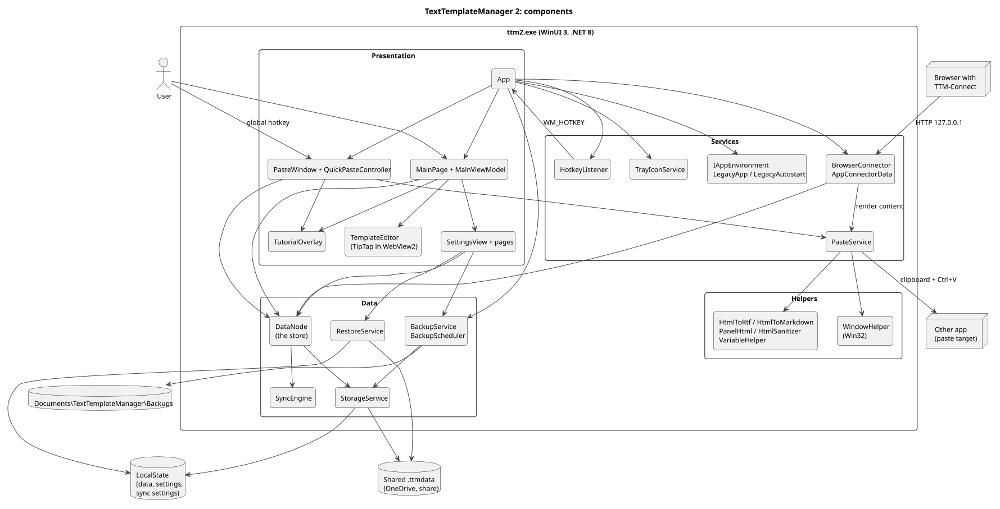
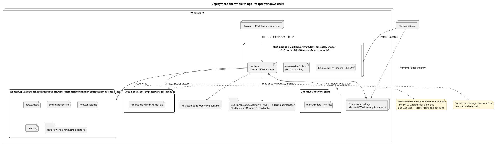

# 1. Overview

TextTemplateManager stores reusable text templates (rich text as HTML) in a tree of folders, gives them single-key and multi-key shortcuts, and pastes them into any other application through a global hotkey window called Quick Paste. Folders can be shared through `.ttmdata` sync files (typically in OneDrive), and a browser extension can list, paste and create templates through a local HTTP connector. The Store package updates itself while it runs (download in the background, **Restart to update**).

## Technology

| Area | Choice |
| --- | --- |
| UI | WinUI 3 (Windows App SDK 1.8), XAML with code-behind and view models (CommunityToolkit.Mvvm, partial `[ObservableProperty]` properties) |
| Runtime | .NET 8, C# 14 (built with the .NET 10 SDK), x64 only |
| Rich-text editor | TipTap in a WebView2 (`src/editor`, bundled by esbuild into single HTML pages under `Assets/editor`) |
| Translation | Bergamot (Firefox Translations, wasm) in a worker of the editor's WebView2; language models in the package's LocalCache |
| Persistence | JSON files via `System.Text.Json` source generation (`StorageJsonContext`) |
| Packaging | MSIX through the Microsoft Store; the Windows App SDK is a Store framework package, .NET is self-contained |
| Win32 | P/Invoke for the global hotkey, clipboard, `SendInput`, low-level keyboard hook, window subclassing, session-end messages |
| Tests | xUnit, `tests/run-tests.ps1` |

## Solution layout

| Path | Contents |
| --- | --- |
| `src/TextTemplateManager/` | The app (`ttm2.exe`) |
| `  App.xaml.cs` | Startup, single instance, global services, exit, tour orchestration, the update switch |
| `  MainPage.*`, `PasteWindow.*`, `*SettingsPage.*` | Windows and pages (code-behind); `*.Tour.cs` holds each window's tour steps |
| `  ViewModels/` | `MainViewModel`, `TreeNode`, `ItemDraft`, `MultiSelection`, `ConflictReport`, `QuickPasteController`, `ShortcutRow` |
| `  Models/` | Items, settings, sync settings, `SyncEngine`, `ShortcutValidator`, `TemplateSearch`, tree helpers |
| `  Data/` | `DataNode` (the store), `StorageService` (file IO), backups and restore |
| `  Services/Platform/` | Environment (packaged or dev), hotkey, tray, browser connector, TextTemplateManager 1 handling, error handler, log export |
| `  Services/Pasting/` | `PasteService` (clipboard and `Ctrl+V`) |
| `  Services/Updates/` | The in-app updater: `UpdateService`, Store and test sources, package switch, update policy (see [13](13-updates.md)) |
| `  Helpers/` | HTML conversions (RTF, Markdown, panels, sanitizer), template variables, Win32 window helpers, converters, `Loc` (UI text set in code) |
| `  Strings/<language>/` | UI text (`Resources.resw`), the guided tour's texts and samples (`Tour.resw`) and the editor page's text (`Editor.resw`); en-US is the source (see [11](11-platform-build-release.md)) |
| `  Controls/` | User controls: editor, settings view, conflict panel, search options, tutorial overlay, About |
| `  Tutorial/` | Tour steps and sample data, startup greeting, What's new parser |
| `src/editor/` | TipTap editor and preview sources, the translator worker, their JavaScript tests |
| `tests/TextTemplateManager.Tests/` | xUnit tests |
| `tools/ManualGen/` | Renders the Markdown manuals to PDF (QuestPDF) |
| `build/` | Release build, release-notes and website scripts, the pseudo-language generator |
| `website/` | The documentation site's own pages and MkDocs settings (see [11](11-platform-build-release.md)) |
| `design/logo/` | The logo as SVG and the script that renders the icon and tile assets from it |
| `design/store/` | Store listing images: Photoshop scripts and templates, window captures, the rendered PNGs |
| `releases/vX.Y.Z/<language>/` | Per release and UI language: `release.md` (release notes, in-app What's new), `store.md` (Store listing and What's new), `screenshots/` (see [11](11-platform-build-release.md)) |
| `.github/workflows/release.yml`, `publish-when-live.yml`, `pages.yml` | Release workflow, publishing the GitHub release once the Store has the version live, and the documentation website (see [11](11-platform-build-release.md)) |
| `.github/workflows/tests.yml`, `codeql.yml`, `.github/dependabot.yml` | Tests on pushes and pull requests, code scanning, dependency updates (see [11](11-platform-build-release.md)) |

## Layers

The app has three layers plus platform services. Dependencies point downward; the data layer knows nothing about WinUI.

- **Presentation**: `App`, the windows and pages, user controls, view models. Runs on the UI thread.
- **Data**: `DataNode` holds the one in-memory tree and the settings and owns all saving; `StorageService` does the file IO for one data folder; backups and restore work on the files. One `DataNode` instance is created by `App` and passed to every window, so the guided tour can run a second, separate instance over sample data.
- **Models**: plain observable classes plus pure logic (merge, validation, search).
- **Services and helpers**: Win32 and platform integration, pasting, the connector, HTML conversions.

([source](diagrams/component-overview.puml))

## Threads

- The **UI thread** owns the tree (`DataNode.LocalItems`), the view models and all windows. Tree edits happen there.
- `DataNode` reads and writes files asynchronously, so the UI doesn't wait on the disk; events (`DataSaved`, `TreeChanged`, `ShortcutsChanged`) can arrive on any thread and listeners marshal back with `DispatcherQueue`.
- The **backup scheduler** runs on a thread-pool timer (every 30 s).
- The **browser connector** accepts and serves connections on the thread pool, reading an immutable snapshot; a create request is marshalled to the UI thread.
- The **hotkey** arrives on a message-only window on the UI thread.
- The **updater** checks on a thread-pool timer (every 6 hours from the last check, also of an earlier run, at the earliest 2 minutes after the start); its `Changed` event is marshalled to the UI thread. The idle-install check is a one-minute dispatcher timer.

## Deployment

([source](diagrams/deployment.puml))

The installed app lives in the read-only package folder. All user data is in the package's `LocalState` folder (removed by Windows on Reset and Uninstall); automatic backups go to `Documents\TextTemplateManager\Backups` so they survive both. Translation models, which can be downloaded again, are in the package's `LocalCache`. Sync files live wherever the user put them. The environment variable `TTM_DATA_DIR` redirects the data folder, the backups and the 1.x folder for tests and dev runs (see [11](11-platform-build-release.md)).

---

[Contents](README.md) · [2. Data model and files →](02-data-model-and-files.md)
