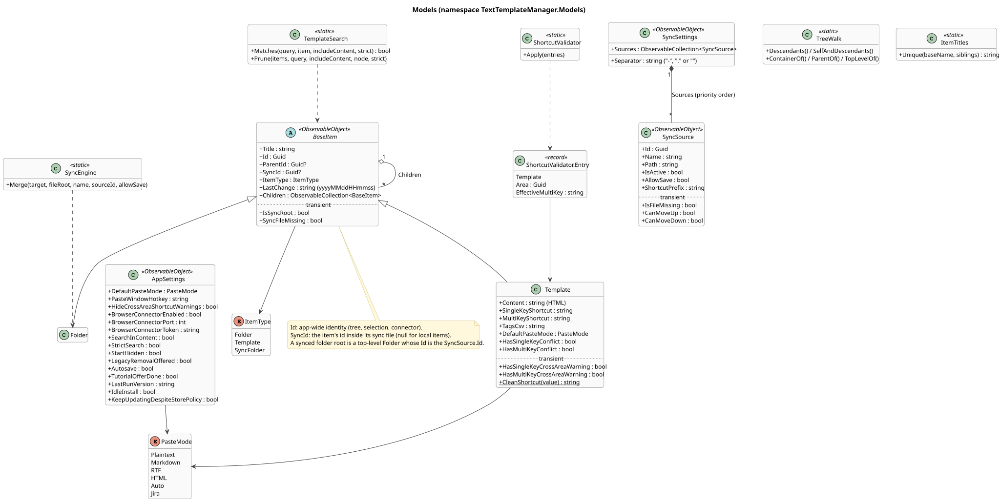

# 2. Data model and files



([source](diagrams/class-model.puml))

## Items

The tree is made of `BaseItem`s: `Folder`s and `Template`s. A folder holds any items; a template is a leaf. A `Template` stores:

- `Content`: HTML as the TipTap editor writes it (callout panels are `div[data-panel-type]`, code blocks `pre > code.language-*`). Early 1.x versions stored RTF; `LegacyRtf.ConvertTree` converts such templates to HTML once, when a file is read, so everything after loading only sees HTML.
- `SingleKeyShortcut`, `MultiKeyShortcut`: cleaned on every set by `Template.CleanShortcut` (trimmed, uppercase, `A-Z` and `0-9` only). `-` and `.` are reserved as the separator between a sync folder's prefix and a shortcut.
- `TagsCsv`, `DefaultPasteMode`.
- `HasSingleKeyConflict` / `HasMultiKeyConflict` (written to the file, part of the format) and the transient cross-area warnings, all computed by `ShortcutValidator`. Changing them doesn't count as an edit (no `LastChange`, no save).

`LastChange` (`yyyyMMddHHmmss`, local time) is set by `DataNode` whenever a persisted property changes. It decides which side wins in sync merges and in "overwrite only where more recent" imports.

### Identities

| Property | Meaning |
| --- | --- |
| `Id` | The app-wide identity of an item: tree nodes, selection, drafts, connector ids. Unique in the tree. |
| `SyncId` | Only for items inside a synced folder: the item's id inside its sync file. `null` for local items. A synced folder's root is a top-level `Folder` whose `Id` is the `SyncSource.Id` and whose `SyncId` is the file root's id (usually `Guid.Empty`). |
| `ParentId` | Written for the file format (and 1.x), kept up to date on add, move and import, but never relied on: the `Children` collections are the structure. |
| `ItemType` | `Folder` or `Template`; `SyncFolder` exists in the enum for the file format and isn't used. |
| `IsSyncRoot`, `SyncFileMissing` | Transient (`[JsonIgnore]`): the item is a synced folder's root; its file is missing and the cached copy is shown. |

### Areas and shortcuts

An **area** is either "local" (`Guid.Empty`) or one sync source (its `Id`). `DataNode.GetAreaKey` finds an item's area through its top-level ancestor.

- A **single key** may repeat across areas; `DataNode.ResolveSingleKey` picks the local template first, then the sync sources in their configured order (`GetSourcePriority`).
- A **multi key** is compared and typed in its **effective** form: in a synced folder with a prefix, `prefix + separator + key` (for example `TEAM.REL`); the template itself still stores just `REL` (`DataNode.GetEffectiveMultiKey`).
- `ShortcutValidator.Apply` takes every template with its area and effective multi key (`DataNode.ShortcutEntries()`): the same key twice in one area is a **conflict** (shown in the conflict panel, must be resolved); the same key in different areas is a **cross-area warning** (allowed, dismissible).
- Moving items into another area (`DataNode.MoveItemsAsync`) clears a clashing single key and suffixes a clashing multi key (`MSG` becomes `MSG1`), and drops the moved items' `SyncId`s so the next sync write assigns fresh file ids.

### Search

`TemplateSearch.Matches` is used by both windows:

- **Normal**: every word of the query must appear in the item's title or tags (and, with `SearchInContent`, its plain text), in any order; a word's letters only have to appear in order (`mtg` finds *Meeting*).
- **Strict** (`StrictSearch`): the query is one phrase as typed, matched against each field on its own (title, tags, text), case ignored; `*` matches any characters, `.` exactly one, a backslash escapes. In the tags the words may come in any order, each in one of the tags.
- `TemplateSearch.Prune` cuts a tree down to the matches and their ancestors.

## Files

All files are UTF-8 JSON without BOM (a BOM is accepted when reading), written indented, `null` values omitted, with relaxed escaping so HTML stays readable. Serialization uses compile-time metadata (`StorageJsonContext`). The exact format is pinned by `FileFormatTests` and fixtures in `tests/.../Fixtures/`: sync files are shared with TextTemplateManager 1, which drops unknown fields when it writes, so the format must not change while 1.x is in use.

| File | Type | Where |
| --- | --- | --- |
| `data.ttmdata` | `Folder` (the root, `Id = Guid.Empty`, title "Root") | Data folder |
| `settings.ttmsettings` | `AppSettings` | Data folder |
| `sync.ttmsettings` | `SyncSettings` | Data folder |
| `crash.log` | Text, appended | Data folder |
| `update.log`, `update-checks.txt`, `update-attempt.json`, `update-watchdog.ps1` / `.xml` | The updater's log, its check times (Store limits), the switch in progress, the watchdog task (see [13](13-updates.md)) | Data folder |
| sync file (`*.ttmdata`) | `Folder` root as written by `DataNode.BuildFileTree` | Anywhere (OneDrive, share) |
| exported file (`*.ttmdata`) | `Folder`: a folder export has that folder as root, a full or multi-item export a plain root (multi-item: tree order, folder copies down from the shared level, `DataNode.ExportTree`); no `SyncId`s | Anywhere |
| backup (`ttm-backup-*.zip`) | Zip with the files above and `manifest.json` | Backups folder (see [5](05-backups-and-restore.md)) |

A tree file looks like this (polymorphism through the `$type` discriminator, `Title` written last):

```json
{
  "Id": "00000000-0000-0000-0000-000000000000",
  "ItemType": 0,
  "LastChange": "20260101120000",
  "Children": [
    {
      "$type": "folder",
      "Id": "11111111-1111-1111-1111-111111111111",
      "ParentId": "00000000-0000-0000-0000-000000000000",
      "SyncId": "99999999-9999-9999-9999-999999999999",
      "ItemType": 0,
      "LastChange": "20260101120001",
      "Children": [
        {
          "$type": "template",
          "Content": "<p>Hello <strong>world</strong></p>",
          "SingleKeyShortcut": "G",
          "MultiKeyShortcut": "MSG",
          "TagsCsv": "mail, hello",
          "DefaultPasteMode": 2,
          "HasSingleKeyConflict": false,
          "HasMultiKeyConflict": false,
          "Id": "22222222-2222-2222-2222-222222222222",
          "ParentId": "11111111-1111-1111-1111-111111111111",
          "ItemType": 1,
          "LastChange": "20260101120002",
          "Children": [],
          "Title": "Greeting"
        }
      ],
      "Title": "Team"
    }
  ],
  "Title": "Root"
}
```

`data.ttmdata` also holds each active synced folder (a top-level folder with a `SyncId`) as a **cached copy**: it is what the folder shows while its sync file is missing, and what a restore can put back.

`DefaultPasteMode` is stored as a number: `Plaintext` 0, `Markdown` 1, `RTF` 2, `HTML` 3, `Auto` 4, `Jira` 5 (shown as "HTML/Jira").

`AppSettings` fields are listed in the class diagram. Besides user choices it holds this installation's state: `LegacyRemovalOffered`, `TutorialOfferDone` and `LastRunVersion` (see [9](09-lifecycle.md)); a restore keeps the latter two from the current settings. The update switches `IdleInstall` and `NoAutomaticUpdates` (automatic updates off, stored inverted) are written only when on (`JsonIgnoreCondition.WhenWritingDefault`), so settings files without them keep their format. A `KeepUpdatingDespiteStorePolicy` left by 2.2 is ignored. `TranslateFrom` and `TranslateTo`, the Translate menu's last languages, are null until chosen and then not written, and `TranslateFormal` is written only when on, for the same reason.

`SyncSettings` holds the sources in priority order (index 0 first) and the `Separator` (`-`, `.` or empty; anything else is migrated to `-` on load).

---

[← 1. Overview](01-overview.md) · [Contents](README.md) · [3. Storage and saving →](03-storage-and-saving.md)
