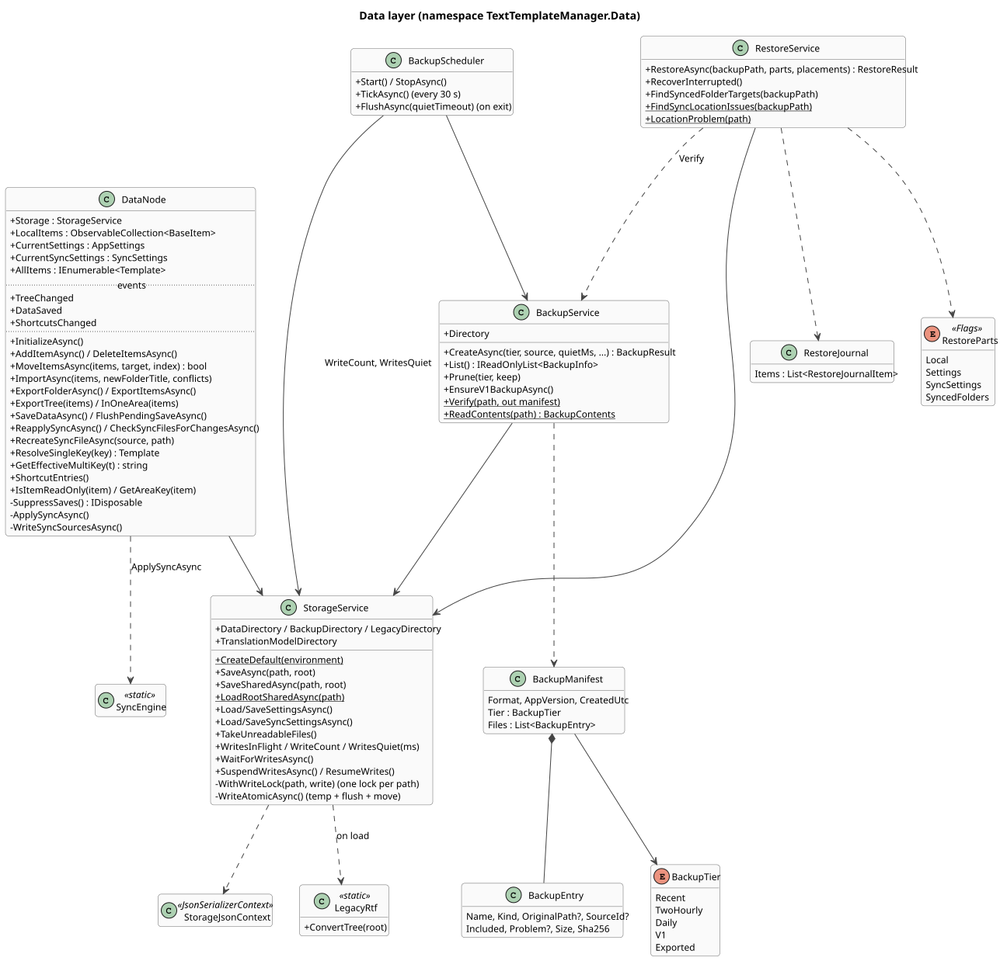
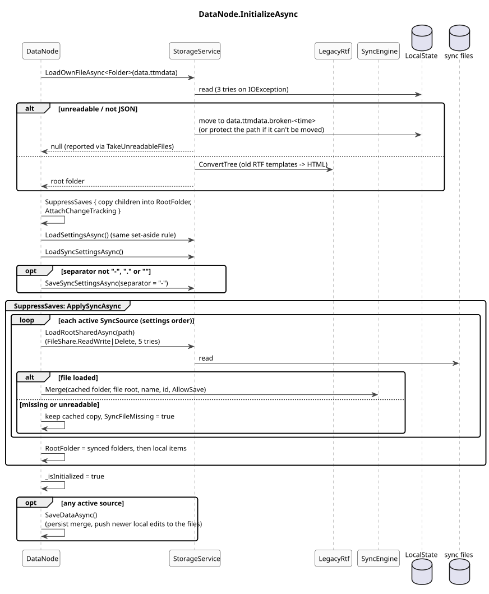
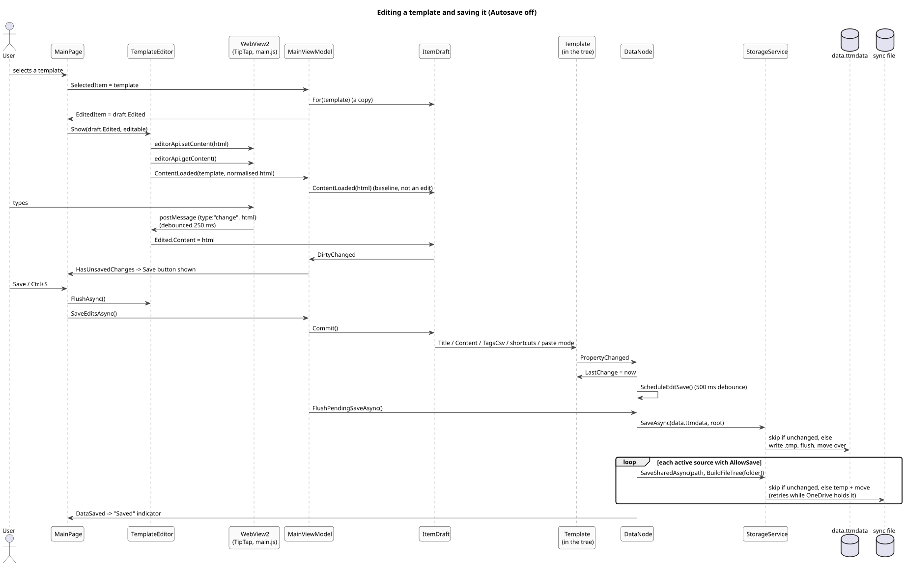

# 3. Storage and saving

([source](diagrams/class-data.puml))

## StorageService: file IO for one data folder

One `StorageService` instance exists per data folder (the app's, the tour's sample folder, each test's scratch folder). `StorageService.CreateDefault(environment)` picks the folder from the environment, or from `TTM_DATA_DIR` when set (then backups and the 1.x folder are looked for inside it too).

**Writes**

- Every write of a path goes through `WithWriteLock(path, ...)`: one `SemaphoreSlim` per path, so two saves of the same file never overlap (a slow OneDrive file doesn't hold up the others).
- Own files are written **atomically**: to `<file>.tmp`, flushed to disk, then moved over the target (`WriteAtomicAsync`). A crash leaves the old or the new file, never a mix.
- Tree files are **skipped when unchanged** (`SaveAsync`, `SaveSharedAsync` compare the serialized text with the file), so modified times don't churn; this matters for sync files on OneDrive, where a needless rewrite on several PCs creates conflict copies.
- Sync files are read and written **shared** (`FileShare.ReadWrite | Delete`) with retries, because OneDrive briefly locks them.
- Write activity is visible to others: `WritesInFlight`, `WriteCount` (writes that changed a file), `WritesQuiet(ms)` and `WaitForWritesAsync()`. Backups wait for quiet; exit waits for writes to finish.
- `SuspendWritesAsync()` drops every later save; a restore uses it so nothing the running app holds overwrites the restored files. `ResumeWrites()` undoes it when the restore failed.

**Reads**

- `LoadOwnFileAsync<T>` (data, settings, sync settings): a file that exists but can't be read or parsed is **set aside** as `<file>.broken-<date-time>` and reported (`TakeUnreadableFiles()`), so the next save can't replace it with an empty tree or defaults. If it can't even be moved, its path is protected: it is never written this session.
- `LoadRootSharedAsync` (sync files, imports) returns `null` on failure; the caller treats the file as missing.

## DataNode: the store

`DataNode` owns the in-memory state for one data folder:

- `LocalItems` (the root's children): synced folders first (in sync-settings order), then local items.
- `CurrentSettings` (`AppSettings`) and `CurrentSyncSettings` (`SyncSettings`).
- Events: `TreeChanged` (after a sync re-apply or a connector create; the main window re-projects the tree), `DataSaved` (after a successful write; "Saved" indicator, connector snapshot), `ShortcutsChanged` (any shortcut edit or sync apply; revalidation).

### Loading

([source](diagrams/seq-store-load.puml))

`InitializeAsync` runs once (it is called by `App` at launch and again, as a no-op, by `MainViewModel`).

### Change tracking and the save path

`AttachChangeTracking(item)` subscribes to `PropertyChanged` and `Children.CollectionChanged` of an item and everything below it. Then:

- **A property edit** (title, content, tags, shortcuts, paste mode) sets `LastChange = now` and schedules a save **500 ms after the last edit** (`ScheduleEditSave`), so typing doesn't write on every keystroke. The conflict flags are excluded.
- **A structural change** (add, delete, move, import) saves at once.
- **A settings change** is saved 500 ms after the last one (`ScheduleSettingsSave`); pages never save settings themselves.
- `FlushPendingSaveAsync()` writes a pending edit or settings save now (Save button, exit).

`SaveDataAsync()` (one at a time, `_saveLock`) writes `data.ttmdata`, then each active sync source with saving allowed (`WriteSyncSourcesAsync`), then raises `DataSaved`.

**Save suppression.** `SuppressSaves()` returns a scope; while any scope is open (counted, so nested scopes are safe) neither change tracking nor `SaveDataAsync` writes anything. It wraps loading, multi-item deletes, moves, imports and sync applies, which then save once at the end.

([source](diagrams/seq-edit-save.puml))

With **Autosave** on, the right pane edits the tree item itself, so every edit takes the debounced path above directly. With it off (the default) the pane edits an `ItemDraft` copy and nothing reaches the tree until Save; see [6](06-main-window.md).

### Import and export

- `ImportAsync(items, newFolderTitle, conflicts)`: into a new folder (every id renewed), or merged directly into the local root: folders matched by id, then by title, are merged; an existing template (same id, or same title in the same folder) is overwritten always, only when the imported one is newer, or skipped (`ImportConflicts`). Imported items become plain local items (`SyncId` cleared, ids already in the tree renewed). `CountImportConflicts` is the dry run for the dialog. Synced-folder snapshots inside an older full export are skipped (`ImportedItems`).
- `ExportFolderAsync` / `ExportItemsAsync`: a serialized copy with `SyncId`s removed, so the file is a plain export and never mistaken for another PC's synced folder.
- `ExportTree(items)` lays out a multi-item export: tree order; each item under copies of its folders below the deepest folder all items share (a synced folder's root at the most, never in the file; a selected sync root stands for its children); the copies hold only exported items, an item inside another exported folder comes along with it. `InOneArea` is false for items of different areas (local, each synced folder): such a selection can't be exported (`ExportTree` throws; the menus are disabled via `MainViewModel.CanExportSelection`).

### Moving

`CanMove` refuses pinned sync roots, anything read-only (a sync source with saving off), and moving a folder into itself. `MoveItemsAsync` moves several items together in their tree order, inserts after the pinned synced folders at the top level, and resolves shortcut clashes when the area changes (see [2](02-data-model-and-files.md)).
