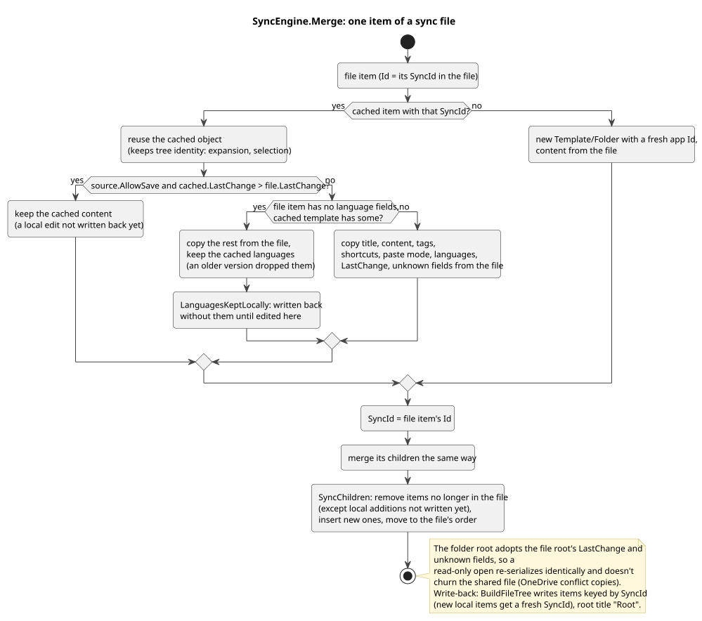
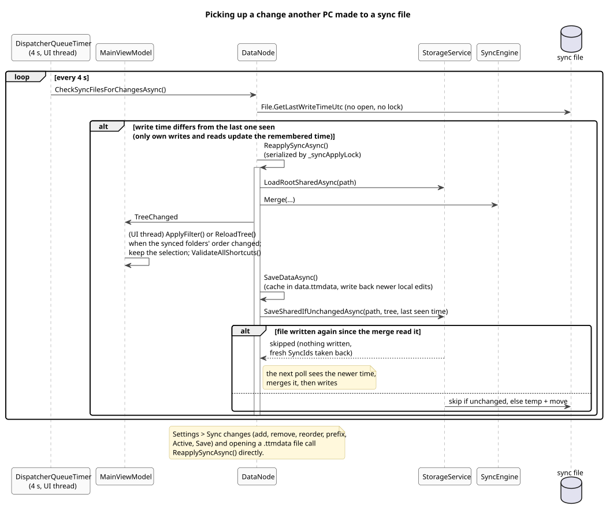

# 4. Sync

A **sync source** (`SyncSource`) links a shared `.ttmdata` file (for example in OneDrive or on a network share). Each active source appears as a pinned folder at the top of the tree. Several people or PCs edit the same file; TextTemplateManager 1 can share the same files.

| `SyncSource` field | Effect |
| --- | --- |
| `Id` | The app-side id of the source's folder (its root's `Id`), stable across restarts and reorders |
| `Name` | The folder's title on this PC (the file's own root title is always "Root") |
| `Path` | The file |
| `IsActive` | Inactive sources aren't loaded; their cached folder is dropped |
| `AllowSave` | Off: read-only, the file always wins and nothing is written back |
| `ShortcutPrefix` | Namespaces the folder's multi keys (`TEAM` + separator + `REL`) |

The list order is the priority order for single keys repeated across areas (local first, then sources top to bottom).

## Applying sync

`DataNode.ApplySyncAsync` rebuilds the top level from the sync settings: for each active source it reads the file and merges it into the cached folder (`SyncEngine.Merge`); a missing or unreadable file keeps the cached copy and flags `SyncFileMissing`. Then the root's children are set to the synced folders (settings order) followed by the local items; sources that were removed or deactivated simply aren't added again.

([source](diagrams/act-sync-merge.puml))

Items are matched by `SyncId` and **reused in place**, so the tree keeps expansion and selection, and an open draft can be rebased onto the same item (see [6](06-main-window.md)). An id that occurs more than once in a file (hand edits, merged conflict copies) stays as it is, and each occurrence takes its own cached item, in tree order, because one object in two places breaks the tree. The merge rule:

- `AllowSave` off: the file wins.
- `AllowSave` on, with a last synced copy of the item: merged field by field (`SyncMerge`). `DataNode` keeps, per source and file path, the file's items as it last read or wrote them (`_lastSynced`), and saves them after the data file to `SyncState` in the data folder (one file per source and path, not synced and in no backup), so they survive a restart; copies of removed or inactive sources and old paths are deleted. Saving after the data file means a crash in between leaves a copy older than the data, which merges fine; a newer one would make edits in the data look like they were taken back here. Each field (title, shortcuts, tags, paste mode, unknown fields) and each language tab (matched by its id: language, content, its unknown fields) is compared on both sides with that copy: changed on one side only, that side's value is taken; changed on both, the newer `LastChange` wins it. A tab added on one side is added; one removed on one side is removed, unless the other side changed it. The tab order comes from the side that reordered the tabs both have. So two PCs editing different languages or fields of one template keep both edits. The first tab gets its id only when a second tab is added, so two sides may know it under different ids or one under none: they count as the same tab unless that id is another tab on the other side (a tab made the first one). The merged item's `LastChange` is the file's when it equals the file (nothing to write back), the cached one when only local edits were taken, else a new time newer than both, so a PC without a copy to compare with still takes it. A cached item older than its last synced copy holds no edit made here (e.g. a local save lost after the file was written) and takes the file. PCs on 2.7 or 2.8 still use the rule below: they take a merged template because it is newer, but when one of them merges first, its whole template wins, and this PC can't tell that from an edit there, so the other side's edits to that template are lost as with the old rule.
- `AllowSave` on, without one (an item new on either side, or the first read of a source): the newer `LastChange` wins, so a local edit that hasn't been written back yet survives a re-apply, and a newer edit from another PC replaces an older local one. Items added here whose write was skipped or failed (see below) aren't in the file yet; they have no `SyncId` and stay where they are (`DataNode` keeps them in memory only, so after a restart the file decides again).

The winning side brings its fields of newer versions too (`UnknownFields`, see [2](02-data-model-and-files.md#fields-of-newer-versions)); the folder root always takes the file root's.

**Languages from a version that doesn't know them.** 1.x and 2.0 to 2.6 drop a template's language fields when they write a sync file. A file item without any of them (`Language`, `LanguageId`, `AltLanguages`) for a cached template that has them was written by such a version, because a version that knows languages never removes `Language` once set. Then the cached languages stay, whatever the `LastChange` (this check comes before the field-by-field merge, which would take the missing tabs as removed), and the file's other fields are taken as usual (`SyncEngine.KeepsLanguages`): its other tabs if it has any, a first tab's language alone only while the file brings no newer edit. The template is marked `LanguagesKeptLocally` (transient) and, when the file brought a different first tab, `DefaultChangedSinceLanguages`. A file item that has `Language` but no other tabs is a real removal and is taken.

## Writing back

`SaveDataAsync` calls `WriteSyncSourcesAsync`: for each active source with `AllowSave` and an existing file, `BuildFileTree` turns the synced folder into a file tree keyed by `SyncId` (items added locally get a new `SyncId` here), and `StorageService.SaveSharedIfUnchangedAsync` writes it when it differs from the file. The root's title is always "Root" and its `LastChange` is the file's, so PCs with different local names write identical files. A template marked `LanguagesKeptLocally` is written without its language fields, as the older version left it, so the two versions can't rewrite the file against each other; any edit of the template here clears the mark (`DataNode.OnItemPropertyChanged`) and its languages are written again.

The write only goes ahead while the file still has the write time DataNode last saw (from its own read or write of it). A file changed since then holds another PC's edit that isn't merged yet, and writing the older merge over it would lose that edit: the write is skipped, the remembered time stays, and the next poll sees the change, merges it and then writes. This covers both a change that lands between a re-apply's merge and its save, and a local edit saved before the poll noticed an outside change. The `SyncId`s the skipped write assigned are taken back, so the items it would have added survive that merge. Local edits survive it field by field (or by their newer `LastChange` without a last synced copy); after a successful write the written tree becomes the last synced copy; a local delete, move or reorder racing an outside change is undone by it (the file's structure wins), which only needs doing again, while the other PC's edit is kept. The check and the move are not atomic, so a write landing in the same moment can still be lost.

A write that fails (a read-only file, a share refusing writes, a lock outlasting the retries) leaves no `<file>.tmp` behind: `SaveSharedAsync` removes it and returns the reason. The changes stay in the local data; `SetWriteProblem` puts the message on the source (`SyncSource.WriteProblem`, a warning on its Settings > Sync row) and on its folder (`SyncWriteProblem`, a warning icon in the tree), and while any source has one, the 4-second poll calls `SaveDataAsync` again until the write succeeds and the warnings clear.

A source whose file is missing is never written back automatically; the user chooses **Recreate the file from the cached copy** (`RecreateSyncFileAsync`, writes the cached folder to the old or a new path and relinks) or **Link another file** in Settings > Sync.

## Noticing changes from other PCs

([source](diagrams/seq-sync-cycle.puml))

`MainViewModel` polls every 4 seconds (`CheckSyncFilesForChangesAsync`). The poll only reads each active file's last-write time; DataNode remembers the time after its own reads and writes, so only a change made elsewhere triggers `ReapplySyncAsync`. The poll doesn't remember a changed time itself; the merge that reads the file does (a missing file is remembered as no time, so a file that shows up later counts as a change). A file that stays locked through the read's retries (`StorageService.ReadRootSharedAsync` reports `Locked`, e.g. OneDrive uploading it) is shown as missing and its time is not remembered, so the next poll reads it again; a file that doesn't load is not retried until it changes. Re-applies are serialized (`_syncApplyLock`), because the poll, a settings change and opening a `.ttmdata` file can overlap.

After a re-apply, `TreeChanged` makes `MainViewModel` refresh the tree in place (`ApplyFilter`), or rebind it completely (`ReloadTree`) when the synced folders' order changed, because WinUI's `TreeView` can't move items of its bound root collection. The selection is put back if the refresh dropped it, and shortcuts are validated again.

## Opening a .ttmdata file

The package registers `.ttmdata`. Opening one (double-click, Open with) activates the app with the file; a second launch hands the activation to the running instance (`AppInstance.RedirectActivationToAsync`). `MainPage.HandleOpenTtmDataFile` links it as a new active source and shows Settings > Sync (or just shows it when it is already linked; the app's own data file is never added).

---

[← 3. Storage and saving](03-storage-and-saving.md) · [Contents](README.md) · [5. Backups and restore →](05-backups-and-restore.md)
