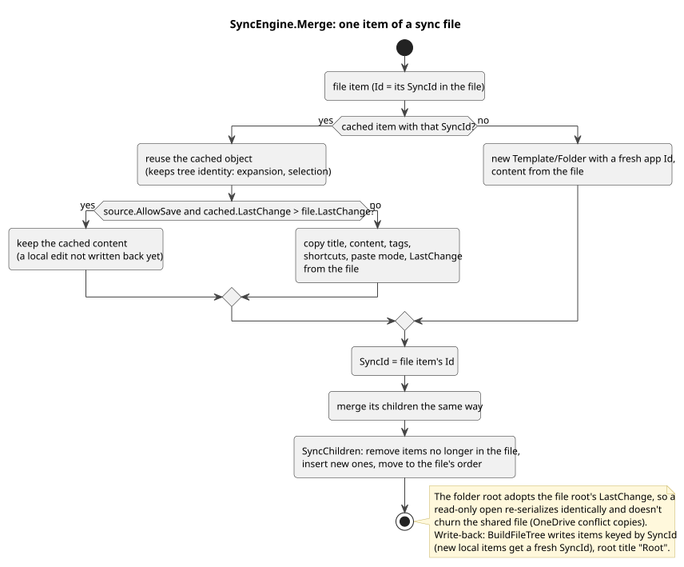
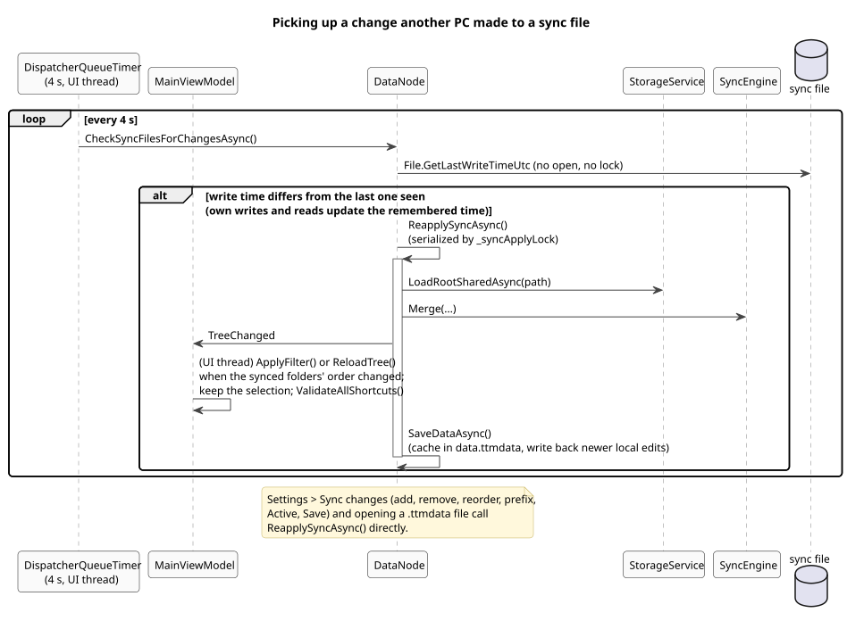

# 4. Sync

A **sync source** (`SyncSource`) links a shared `.ttmdata` file (for example in OneDrive or on a network share). Each active source appears as a pinned folder at the top of the tree. Several people or PCs edit the same file; TextTemplateManager 1 can share the same files.

| `SyncSource` field | Effect |
| --- | --- |
| `Id` | The app-side id of the source's folder (its root's `Id`), stable across restarts and reorders |
| `Name` | The folder's title on this PC (the file's own root title is always "Root") |
| `Path` | The file |
| `IsActive` | Inactive sources aren't loaded; their cached folder is dropped |
| `AllowSave` | Off: read-only, the file always wins and nothing is written back |
| `ShortcutPrefix` | Namespaces the folder's multi keys (`TEAM` + separator + `REL`) |

The list order is the priority order for single keys repeated across areas (local first, then sources top to bottom).

## Applying sync

`DataNode.ApplySyncAsync` rebuilds the top level from the sync settings: for each active source it reads the file and merges it into the cached folder (`SyncEngine.Merge`); a missing or unreadable file keeps the cached copy and flags `SyncFileMissing`. Then the root's children are set to the synced folders (settings order) followed by the local items; sources that were removed or deactivated simply aren't added again.

([source](diagrams/act-sync-merge.puml))

Items are matched by `SyncId` and **reused in place**, so the tree keeps expansion and selection, and an open draft can be rebased onto the same item (see [6](06-main-window.md)). The merge rule:

- `AllowSave` off: the file wins.
- `AllowSave` on: the newer `LastChange` wins, so a local edit that hasn't been written back yet survives a re-apply, and a newer edit from another PC replaces an older local one.

## Writing back

`SaveDataAsync` calls `WriteSyncSourcesAsync`: for each active source with `AllowSave` and an existing file, `BuildFileTree` turns the synced folder into a file tree keyed by `SyncId` (items added locally get a new `SyncId` here), and `SaveSharedAsync` writes it when it differs from the file. The root's title is always "Root" and its `LastChange` is the file's, so PCs with different local names write identical files.

A source whose file is missing is never written back automatically; the user chooses **Recreate the file from the cached copy** (`RecreateSyncFileAsync`, writes the cached folder to the old or a new path and relinks) or **Link another file** in Settings > Sync.

## Noticing changes from other PCs

([source](diagrams/seq-sync-cycle.puml))

`MainViewModel` polls every 4 seconds (`CheckSyncFilesForChangesAsync`). The poll only reads each active file's last-write time; DataNode remembers the time after its own reads and writes, so only a change made elsewhere triggers `ReapplySyncAsync`. Re-applies are serialized (`_syncApplyLock`), because the poll, a settings change and opening a `.ttmdata` file can overlap.

After a re-apply, `TreeChanged` makes `MainViewModel` refresh the tree in place (`ApplyFilter`), or rebind it completely (`ReloadTree`) when the synced folders' order changed, because WinUI's `TreeView` can't move items of its bound root collection. The selection is put back if the refresh dropped it, and shortcuts are validated again.

## Opening a .ttmdata file

The package registers `.ttmdata`. Opening one (double-click, Open with) activates the app with the file; a second launch hands the activation to the running instance (`AppInstance.RedirectActivationToAsync`). `MainPage.HandleOpenTtmDataFile` links it as a new active source and shows Settings > Sync (or just shows it when it is already linked; the app's own data file is never added).
