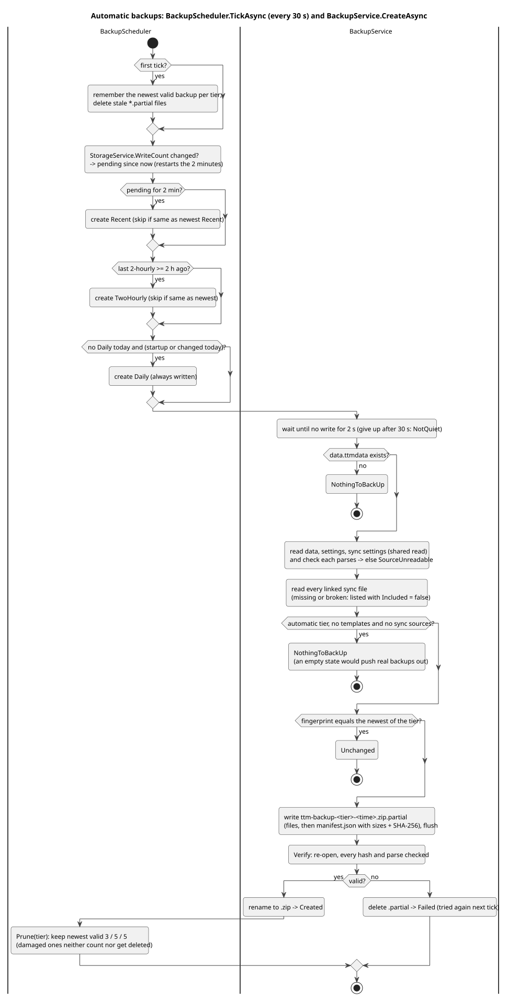
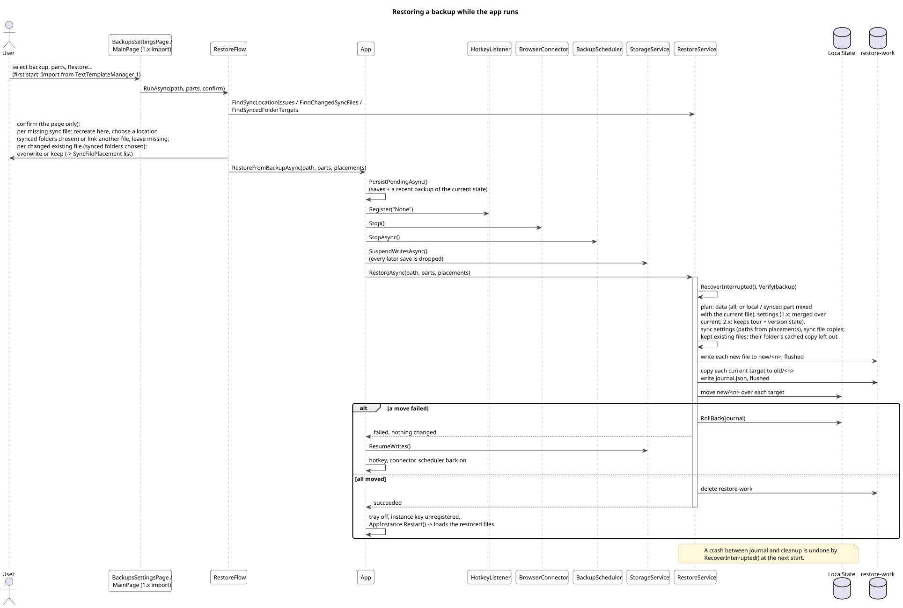

# 5. Backups and restore

## Backup files

A backup is one zip, `ttm-backup-<tier>-<yyyyMMdd-HHmmss>.zip`, in `StorageService.BackupDirectory` (`Documents\TextTemplateManager\Backups` in the Store app; it follows a redirected Documents folder):

| Entry | Content |
| --- | --- |
| `data.ttmdata` | The templates, including the synced folders' cached copies |
| `settings.ttmsettings`, `sync.ttmsettings` | When present |
| `sync/<source id>.ttmdata` | A copy of every linked sync file (listed with `Included = false` and a `Problem` when missing or unreadable) |
| `manifest.json` | Written last: format, app version, creation time (UTC), tier, and per file its kind, size, SHA-256, original path and source id |

A backup is written as `*.zip.partial`, flushed, re-opened and verified in full (every hash, every file parses with the app's own loaders), and only then renamed to its final name. `BackupService.List()` verifies each zip again; a damaged one is listed as invalid, can't be restored, isn't counted and isn't deleted automatically.

| Tier | Made | Kept |
| --- | --- | --- |
| `Recent` | 2 minutes after the last change; on exit when changes aren't backed up yet | 3 |
| `TwoHourly` | every 2 hours while the app runs, if something changed | 5 |
| `Daily` | at startup and at the first change after midnight, once a day | 5 |
| `V1` | once, from TextTemplateManager 1's data folder (`EnsureV1BackupAsync`) | never pruned |
| `Exported` | **Export backup…**, written to the chosen path, not into the folder | n/a |

`Recent` and `TwoHourly` backups aren't written when their files match the newest backup of the tier (fingerprint of each entry's name and hash, or its problem); a `Daily` backup is always written, so every day has one.

([source](diagrams/act-backup.puml))

The scheduler notices changes through `StorageService.WriteCount` (writes that changed a file), not through the UI, so edits from sync and the connector count too. Before copying it waits for 2 seconds without writes (`WritesQuiet`), so a file is never caught mid-write; if writes don't stop within 30 seconds, the backup is tried again on the next tick.

## Restore

Settings > Backups shows the backups and lets the user choose the parts (`RestoreParts`): local templates and folders, settings, sync settings, synced templates and folders. Only parts the backup holds are offered (`BackupService.ReadContents`). `RestoreFlow` asks the questions below and runs the restore; the page uses it after a confirmation, the first start's import from 1.x without one, with every part the v1 backup holds except the synced folders. Shared sync files are only written with the synced folders chosen, which the page never ticks on its own: without them `RestoreFlow` offers no copy for a missing file (only linking another one) and doesn't ask about changed ones, which stay as they are.

([source](diagrams/seq-restore.puml))

What `RestoreService.RestoreAsync` puts back:

- **Data**: all of `data.ttmdata`, or with only one of local / synced chosen, that part from the backup mixed with the other part of the current file (`MixData`).
- **Settings**: from a 1.x backup only the fields 1.x had replace the current ones (`OverCurrentSettings`); from a 2.x backup everything except this installation's tour and version state (`KeepGreetingState`).
- **Sync settings**: the backup's list; for each source whose file isn't on this PC (`FindSyncLocationIssues`: file missing, folder missing, unreachable drive or share, unreadable) the user chooses to write the backup's copy there, at another place, or leave it missing (`SyncFilePlacement`). For each active source whose file exists but differs from the backup's copy (`FindChangedSyncFiles`, compared as trees) the user chooses to overwrite it with the copy or keep it. A kept file stays the only source of its folder: the backup's cached copy of that folder is left out of the restored data (`WithoutCachedFolders`), so at the next load nothing from the backup can outrank the file in the merge.
- **Synced folders without the sync settings**: each synced folder of the backup goes into the file of the matching current source, or of the backup's source (linked again); an existing file gets the templates merged like an import (`FindSyncedFolderTargets`, `MergeFileTree`).

The swap is all or nothing: new files are staged in `restore-work\new`, the current ones copied to `restore-work\old`, a journal is written and flushed, then each file is moved into place. A failure rolls back from the journal; a crash during the swap is rolled back by `RecoverInterrupted()` at the next start. A shared sync file that still exists is only overwritten when the user chose so.

Because the running app holds the old state, `App.RestoreFromBackupAsync` first saves everything (and makes a recent backup, so the restore can be undone), stops the hotkey, the connector and the scheduler, suspends writes, and after a successful restore restarts the app (`AppInstance.Restart`). The first-start "Import from TextTemplateManager 1" (straight through `RestoreFlow`) and "Restore a backup" (Settings > Backups on the newest backup) use the same path.
