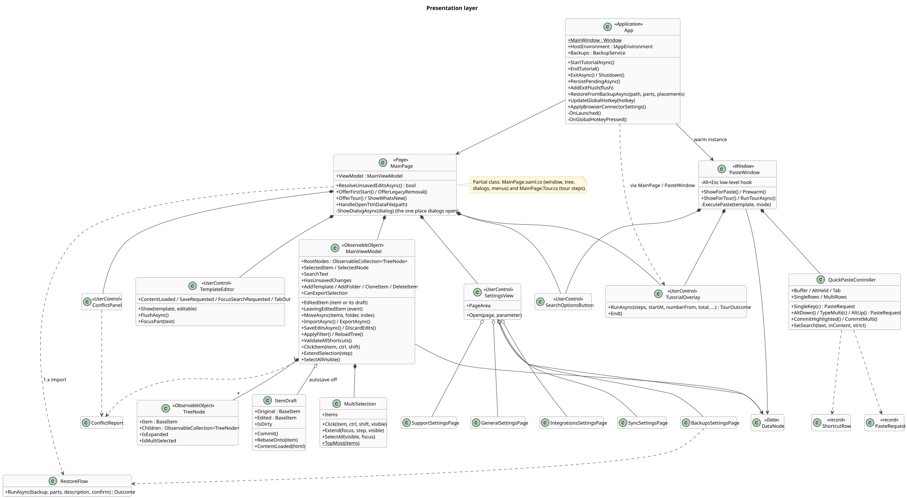
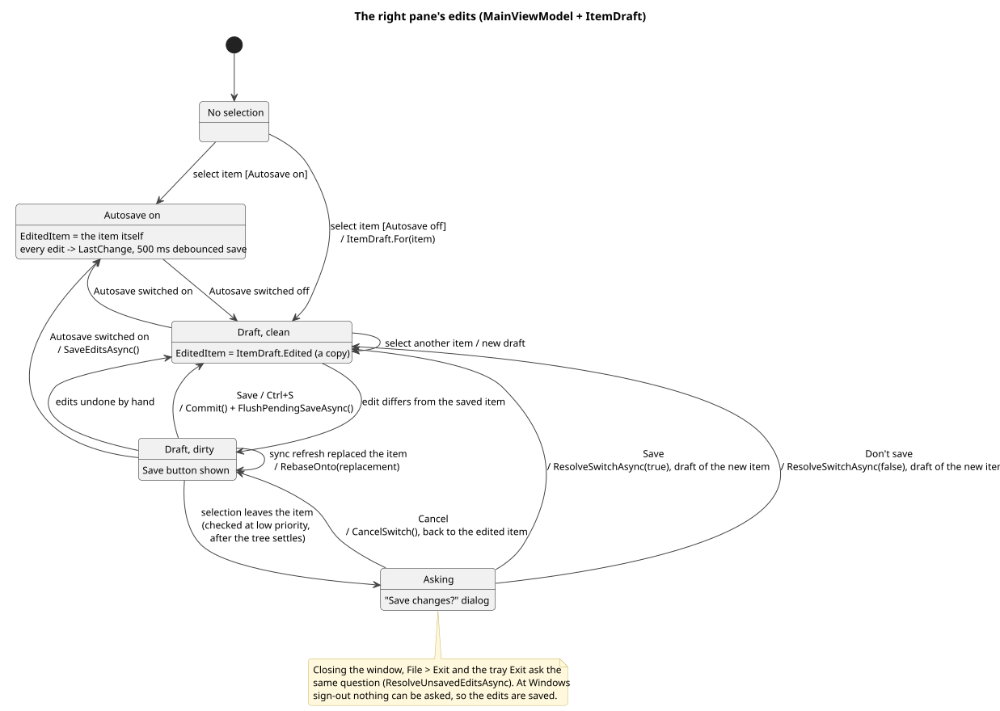

# 6. Main window

([source](diagrams/class-ui.puml))

`App.MainWindow` is a plain `Window` whose `Content` is a `MainPage`. The page is built over a `DataNode` (`new MainPage(store, tour: false)`); the guided tour builds a second page over sample data and swaps it in (see [10](10-guided-tour.md)).

## MainPage

`MainPage` (`MainPage.xaml.cs`, tour steps in `MainPage.Tour.cs`) is the view: menu bar, tree, search box, toolbar, the right pane with `TemplateEditor` and the item's fields, the `ConflictPanel`, the in-window `SettingsView`, and the `TutorialOverlay`. It handles what needs the view: drag and drop on the tree, keyboard navigation, context menus, file pickers, and every dialog.

**Dialogs.** Only one `ContentDialog` may be open at a time, and startup notices arrive on their own schedule, so every dialog goes through `ShowDialogAsync`: it opens nothing while another dialog is open (returns `None`), and startup messages wait until the page is loaded and no dialog is open (`WaitUntilDialogCanOpenAsync`). Startup offers that must not be lost retry when another dialog got there first (`ShowWhenFreeAsync`). The 1.x removal offer keeps the slot while the uninstaller runs, so its result message isn't pushed out by the waiting tour offer.

## MainViewModel

`MainViewModel` holds the window's state over the store:

- **Tree projection.** The tree binds to `RootNodes`, a tree of `TreeNode`s (one node per item for as long as the item exists, `NodeFor`). Nodes carry `IsExpanded` and `IsMultiSelected`; their `Children` are all children, or only the search matches. `ApplyFilter()` updates the nodes in place (`SyncCollection`: add, remove, move), so `TreeView` containers and expansion survive; `ReloadTree()` rebinds a new collection when the top-level order changed.
- **Selection.** `SelectedItem` / `SelectedNode`, plus `MultiSelection` for Ctrl/Shift-click, Shift+Up/Down (`Extend`) and Ctrl+A (`SelectAll`, visible rows) (Explorer rules: the anchor is the last click without Shift; the focused item is the last one). Delete and Export act on `MultiSelection.TopMost` (selected items without those inside another selected folder); `CanExportSelection` disables File ▸ Export and the right-click entry for a selection across areas (label "(not across areas)", since a disabled menu item shows no tooltip).
- **Commands.** Add template / folder (into the selected folder, or the selected template's folder, or the root; refused for read-only synced folders), clone, delete, move (`DropDestination` turns a drop position into folder and index), import and export.
- **Search.** `SearchText` with the shared settings `SearchInContent` and `StrictSearch` (see [2](02-data-model-and-files.md)).
- **Validation.** `ValidateAllShortcuts()` runs `ShortcutValidator` once per batch of changes (`QueueValidation`, on the UI thread) and raises `ConflictsChanged`; the page shows a `ConflictReport` in the `ConflictPanel` (conflicts can't be dismissed, cross-area notes can, until they change).
- **Sync polling.** A 4-second `DispatcherQueueTimer` (see [4](04-sync.md)); `StopBackgroundWork()` stops it for the tour's page.

## Editing and Save

`EditedItem` is what the right pane shows and edits:

- **Autosave on**: the selected item itself. Every edit takes the store's debounced save path.
- **Autosave off** (default): an `ItemDraft`, a copy of the editable fields (title; a template's content, tags, shortcuts, paste mode). The copy is edited; `IsDirty` compares it with the original; `Commit()` copies the changed fields into the tree item, which the store then saves like any edit.

([source](diagrams/state-edit.puml))

Details that keep this correct:

- **Editor baseline.** TipTap normalizes HTML when it loads a template, so the loaded text can differ from the stored text without any edit. The editor reports what it shows (`ContentLoaded`), and the draft takes that as its unedited content.
- **Leaving an item** is decided at low dispatcher priority (`CheckSwitch`), after the selection has settled: a tree refresh can pass through no selection and back, which isn't leaving.
- **Sync refresh.** When a sync re-apply replaces the edited item, the draft moves its edits onto the replacement (`RebaseOnto`); when the item was deleted, the edits go with it.
- **Before anything that ends editing** (Save, selecting another item, closing the window, exit) the page first pulls the editor's latest content (`TemplateEditor.FlushAsync`), because the editor reports changes with a 250 ms delay. A read that fails is ignored, never taken as empty: a script that can't run returns JSON null instead of throwing, and an empty editor still returns `

` (`ContentFromScriptResult`). Taking that null as "" once emptied a synced template at exit.

## TemplateEditor: the WebView2 bridge

The editor is TipTap running in a WebView2 (`src/editor/src/main.js`, built into `Assets/editor/editor.html` with CSS and script inlined; the page is loaded with `NavigateToString`, so nothing is fetched and nothing can be cached stale). The preview in Quick Paste uses `preview.html` the same way. Both pages need their `<title>`: Chromium names its hosting window after it, and without one that name is the whole page as a `data:` URL, which a screen reader reads out when the focus enters the editor. The editing area is a named `role="textbox"`, and toolbar buttons are named by their tooltip (`aria-label`; their content is an icon or a glyph), with `aria-pressed` / `aria-haspopup` / `aria-expanded` for state. Keyboard: the main window's Tab cycle (`MainPage.TabCycle`) is tree toolbar → search → tree → title → editor → shortcuts, tags, paste mode (a folder: its title). The tree toolbar is one stop (Left/Right between enabled buttons, `SearchNavigation.NextInRow`). The editor takes its own keys while it has the focus: its toolbar is one stop with a roving tabindex, Tab from there goes to the end of the text (`editorApi.focusToolbar` / `focusTextEnd`, called through `TemplateEditor.FocusPart`); in the text Tab is left to lists, tables and code blocks, elsewhere the page posts `tabOut` and the host (`TemplateEditor.TabOut`) moves on. The popups work from the keyboard: colour swatches are buttons, the table-size grid takes the arrow keys and Enter (size announced through an `aria-live` label), and Esc closes a popup and returns the focus to its button. On the XAML side, icon-only buttons and controls labelled by a separate TextBlock carry an AutomationProperties.Name; a TreeView reaches screen readers as its inner list, which Helpers/TreeViewNames names (main window and Quick Paste); items shown through ToString() (Quick Paste rows, sync sources) return their title or name.

| Direction | Message | Purpose |
| --- | --- | --- |
| page to app | `{type:"ready"}` | Editor loaded: apply theme, show the requested template |
| page to app | `{type:"change", html}` | Content changed (debounced 250 ms); written to the shown template (by reference, not by selection) |
| page to app | `{type:"save"}` | Ctrl+S in the editor |
| page to app | `{type:"focusSearch"}` | Ctrl+F in the editor |
| page to app | `{type:"openLink", href}` | Ctrl+click on a link, opened in the default browser |
| app to page | `editorApi.setContent(html)` | Show a template (resets undo history per template) |
| app to page | `editorApi.getContent()` | Read the current HTML |
| app to page | `editorApi.setEditable(bool)` | Read-only for synced folders with saving off |
| app to page | `editorApi.setTheme(dark)` | Light/dark |
| page to app | `{type:"translationRefresh"}` | The Translate menu opened: the app answers with `editorApi.setTranslation({sources, targets, from, to})` |
| page to app | `{type:"translationChoice", from, to}` | From or To changed; kept in `AppSettings.TranslateFrom` / `TranslateTo` |
| page to app | `{type:"translationSettings"}` | Manage languages: opens Settings ▸ Translation |

The WebView's context menu is trimmed to editing items (the writing-direction submenu is recognised by its shape, a nameless submenu of checkboxes, since its label is in the app's language); dev tools, the status bar and browser accelerator keys are off. The editor and the Quick Paste preview share one WebView2 environment (`WebViewEnvironment`) created in the app's language, so WebView2's own menu and spelling suggestions match the app.

### Translator

Translation runs offline in the editor's WebView2 with Bergamot, the engine of Firefox Translations (`Assets/translator/bergamot-translator.js` and `.wasm`, v0.6.0, MPL-2.0, checked in as Mozilla publishes them). `editorApi.translateHtml(html, from, to)` (`src/editor/src/translator/client.js`) hands the HTML to a worker (`translator-worker.js`, built from `worker.js`), started on first use and stopped after five minutes without requests, which frees the engine and its models. The editor page is an opaque origin, so the worker is a blob that loads the real one from the virtual host `ttm-translator.example` (mapped to `Assets\translator`); the models come from `ttm-models.example`, mapped to `StorageService.TranslationModelDirectory`. `TemplateEditor` maps both before navigating, with cross-origin reads allowed. A models folder holds one subfolder per direction (`en-de`) with the model, lexical shortlist and vocabulary files and a `model.json` naming them and the registry name of the model (its suffix tells the gemm precision). Pairs exist only to and from English, so other pairs go through English (`engine.route`). The engine settings are Firefox's (`engine.js`). The engine translates HTML with markup kept. Placeholders (`$[DATE]`, `$[TIME(HH:mm)]`, ...) would have their names translated (`$[TIME]` to `$[ZEIT]`), so `mask.js` replaces them with numbered braces (`{0}`, numbered past any braces already in the text), which the models keep, and puts them back afterwards; one the model dropped is appended to the last paragraph. The engine puts tags back by word alignment and sometimes tags a word twice (a link on "here" came back on "Die" and on "hier"); `inline.js` repairs an inline element (same tag and attributes) that comes back more often than it went in: copies right next to each other are merged, of the rest the ones closest to the originals' places in the text are kept and the others unwrapped. A missing pair rejects with `missingPair` set.

The **Translate** button ends the toolbar (`addTranslateControl` in `main.js`). Its menu is rebuilt every time it opens and on every change: From (Detect or a source language), To, Replace template, Create new template, Replace selection (only with a selection), Manage languages, and a status line (`role="status"`). The languages come from the app on each opening (`TemplateEditor.PushTranslationChoices` with `TranslationChoices.From(ModelStore.Installed())`: a source is a language with its model to English installed, a target one with its model from English, English on either side when any model from or to it is), so languages installed meanwhile show up. The remembered From and To count while they are installed (`FromOrDefault`, `ToOrDefault`); without a remembered To the menu picks English, or the first other language when the text is English. Detect (`translator/detect.js`, franc limited to the installed languages; it runs in the translator worker, so its language data, some 300 KB, loads with the menu and not with every template) guesses from the selection, else from the whole template; below about 20 characters (8 in scripts without spaces) there is no guess, and the menu asks to choose From. Simplified and Traditional Chinese share franc's code and are told apart by a few characters. While a translation runs the editor isn't editable. Replace template sets the translated HTML as one transaction (one undo step). Create new template posts `{type:"translationCreate", html, from, to}`; `TemplateEditor.TranslatedCopyRequested` reaches `MainViewModel.CreateTranslatedCopyAsync`, which adds a copy of the selected template placed like a duplicate (next to it, or at the top level when it is in a read-only sync folder) and selects it: title and multi-key shortcut get the target language's tag (`TranslatedCopy`: "Offer" to "Offer (DE)", MSG to MSGDE; a source tag the title already ends with is replaced, so "Offer (DE)" to English is "Offer (EN)" and MSGDE becomes MSGEN; Chinese is ZH and ZH-TW), tags and paste mode are copied, the single-key shortcut is left empty. Replace selection translates the selected slice (text inside one paragraph as a paragraph of its own, keeping the spaces around it) and puts it back with `replaceRange` as an open slice, so the first and last paragraph join the text around the selection, as a paste does. With German as To the menu shows **Formal (Sie)** (`AppSettings.TranslateFormal`); off means informal (du), best effort, with a note in the menu. The models have no formality setting and sometimes say "du" (12 of 229 support sentences in a test, e.g. "I will call you" as "Ich rufe dich an"); behind "Dear Sir or Madam," every one of them came out with "Sie", but that greeting rewords sentences that were fine and can make the model drop a clause. So `formal.js` translates normally, and only lines that came out with "du" are translated again with the greeting in front of each sentence, which is then taken off (it comes back as "Sehr geehrte Damen und Herren," or a mixed-up variant; one per sentence, so a greeting the text has stays). Lines, not paragraphs: the engine takes a line break (` `) as the end of a sentence, so a sentence after one got no greeting, and a greeting in front of a line that was fine changes it too ("Dear Ms/Mr @" became "Liebe Frau/Herr" instead of "Sehr geehrte Frau/Herr"); a paragraph whose lines split a tag goes as a whole, with a line break counting as a sentence start. The new line replaces the first one only when every greeting came off, no "du" is left and it is at least 85% as long. Informal works the same way the other round (`INFORMAL`): lines that came out with "Sie" (or "Ihnen", "Ihr…") are translated again between "Hey Tom," and ", Tom" (before each sentence's closing punctuation), which come back as "Hey Tom," and ", Tom" and are taken off; a line is kept only when both came off for every sentence and no "Sie" is left. It is best effort: in the same test about half of the Sie sentences became informal (the best of the cues tried; "Hi friend,", "Dear friend,", slang and a family-speech frame did worse), so an informal translation can mix du and Sie. A pivot (e.g. French to German) goes to English first, so the German step can translate lines again on their own (`Engine.translate(…, { address: 'formal' | 'informal' })`). The menu is rebuilt inside its own click handlers, so clicks inside it don't propagate to the document's close-on-outside-click handler.

Settings ▸ Translation (`TranslationSettingsPage`) installs the models (`Services/Translation`). `ModelCatalog` reads Mozilla's Remote Settings collection `translations-models-v2`, the list Firefox downloads its models from, and keeps per direction the newest release version of the model format the bundled engine reads (major version 3), skipping records for Android or Nightly only; between sizes of the same version it takes the better one (base, then base-memory, then tiny). `ModelCatalog.Languages` turns the directions into languages, each with its model to and from English, so the page offers languages, not pairs. `ModelStore.InstallAsync` downloads a direction's files from Mozilla's attachment CDN into a `.partial-` folder, checks the SHA-256 of each download and of its unpacked content (zstd, `ZstdSharp.Port`), writes `model.json` with the file names and hashes, and only then swaps the folder in; a failed or cancelled download leaves the installed version as it was. Every installed language shows Update, enabled when its installed hashes differ from the catalog's; **Download all updates** (hidden while the daily check downloads on its own) runs those one language after the other. Downloads outlive the page (a static list keeps the running rows); when one ends, its row is read again from disk and the open page, if any, rebuilds (a static `DownloadEnded` event the loaded page listens to), since the page that started it may be gone. `ModelStore.Busy` / `WhenIdle` / `Progress` (downloaded bytes of all running and waiting installs) / `StopAll` track every install in the app, for the exit question (see [09](09-lifecycle.md)). Two options on the page set the daily update check (`AppSettings.TranslationAutoCheck`, `TranslationAutoInstall`, off by default): `TranslationUpdater` (started by `App` like the backup scheduler) asks every hour, the first time two minutes after the start, whether a day has passed since `TranslationLastCheck`; then it loads the catalog, compares the installed directions (`InstalledPair.Matches`) and either downloads the newer ones (option "Download them automatically") or shows a tray notification. Only installed directions are updated; a failed check or install is tried again at the next tick. `ModelStore.InstallAsync` runs one install at a time in the app (a static gate), since the page and the updater can ask for the same direction, and runs it on the thread pool, reporting progress at most every 100 ms (posting each read chunk to the UI thread froze the window on a fast connection); `ModelStore.Http` is the one client for Mozilla's servers. Export writes the installed folders to a zip and Import installs a zip's folders, each only if its files match the hashes in its `model.json` and its file names stay inside the folder, for PCs without internet access. Without the catalog (offline), installed languages are listed from disk and can still be removed and exported. In the guided tour `SettingsView.Offline` is set, and the page (its parameter is `TranslationSettingsPage.Parameters(ModelDirectory, LoadCatalog)`) doesn't load the catalog, so the tour never goes online.

## Settings

`SettingsView` is an in-window view (not a separate window) with six pages: General (hotkey, default paste mode, start with Windows, start hidden, Autosave, updates: version, Check for updates, automatic updates on/off, with a note where it updates around the Store policy, idle install; cross-area warnings), Integrations (browser connector, extension links, file association), Sync (sources, separator, missing files), Backups (list, export, restore, import from 1.x), Translation (the languages for the editor's translator, see below), Support (website help; **Export logs**, `Services/Platform/LogExport.cs`: the same .zip as the website's log collector, from `IEventLogSource` with `WindowsEventLogSource` reading the Store, AppX deployment and Application logs without admin rights, the app's log files from the data folder (never its data files), `Redactor` replacing profile path, SIDs, user and computer name, run off the UI thread; problem reports, feature requests and vulnerabilities by e-mail or GitHub, links and prefilled `mailto:` forms with app and Windows version from `Common/SupportLinks`, which also holds the website address for Help ▸ Go to website and About). Pages edit `DataNode.CurrentSettings` / `CurrentSyncSettings` directly; the store saves settings on its own, and pages call `App` for side effects (`UpdateGlobalHotkey`, `ApplyBrowserConnectorSettings`, `RestoreFromBackupAsync`). Settings covers the menu bar while it is open.

Help ▸ About (`AboutDialog`) answers **View License** with `LICENSE` and **Third-party notices** with `THIRD-PARTY-NOTICES.txt`, both shipped next to the app (`MainPage.ShowTextFileAsync`). The notices cover every third-party component that ships: the npm packages bundled into the editor, preview and translator pages (TipTap, ProseMirror, linkifyjs, highlight.js, lowlight, franc and their helpers), the NuGet packages (.NET runtime and libraries, Community Toolkits, H.NotifyIcon, Html Agility Pack, RtfPipe, ZstdSharp; Windows App SDK and WebView2 by reference to their Microsoft terms), the Bergamot engine and the models (MPL-2.0, with where the source is) and the Phosphor icon. A new dependency needs its entry there.

The update notice (`UpdateBar`, `MainPage.Updates.cs`) sits between the menu bar and the panes; `App` sends it the updater's status (never to the tour's page). See [13](13-updates.md).

---

[← 5. Backups and restore](05-backups-and-restore.md) · [Contents](README.md) · [7. Quick Paste and pasting →](07-quick-paste-and-pasting.md)
