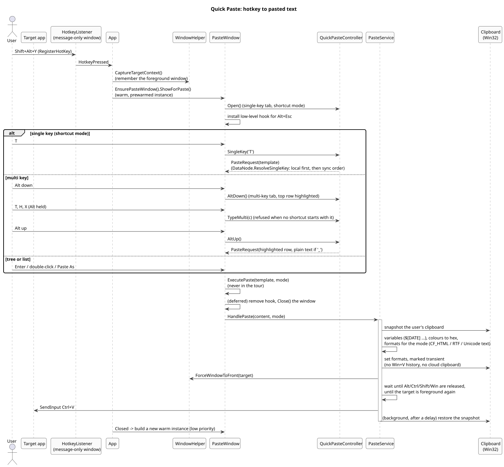
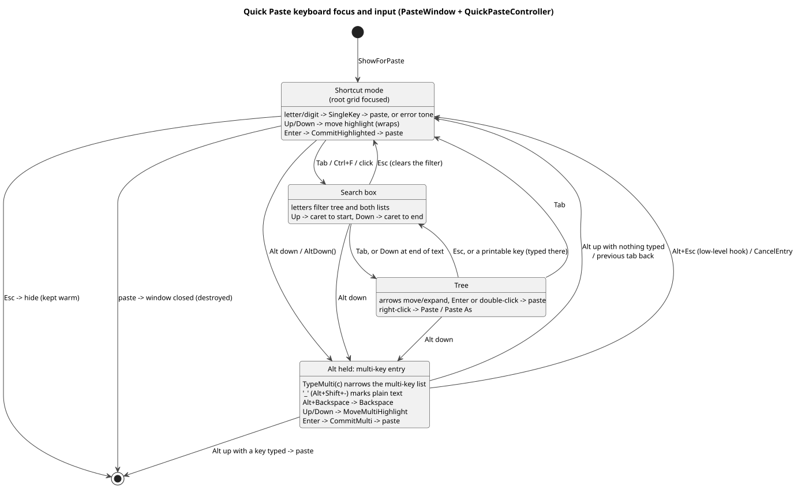

# 7. Quick Paste and pasting

([source](diagrams/class-services.puml))

## From hotkey to paste

([source](diagrams/seq-quick-paste.puml))

**Hotkey.** `HotkeyListener` registers the configured combination (`RegisterHotKey`) on a message-only window and raises `HotkeyPressed`. Registration fails when another app owns the combination; the app reports that at startup and in Settings > General. The tour and a restore register `"None"` to switch it off.

**Target.** Before Quick Paste shows, `WindowHelper.CaptureTargetContext()` remembers the foreground window: that is where the paste goes.

**A warm window.** `App` keeps one hidden `PasteWindow`, prewarmed at low priority after launch (UI, tree and the preview WebView), so the hotkey opens it instantly. Esc and the X **hide** it. A paste **closes** it (a hidden window could be reactivated and swallow the `Ctrl+V` into its own search box), and `App` builds a new warm one on `Closed`.

**Alt+Esc.** Windows uses Alt+Esc to switch windows, so it never reaches WinUI. While Quick Paste is open, a low-level keyboard hook (`WH_KEYBOARD_LL`) swallows it and cancels the multi-key entry instead.

## Input: PasteWindow and QuickPasteController

`QuickPasteController` is Quick Paste's input logic without the window (and unit-tested without it): the single-key and multi-key lists (`ShortcutRow`s, local first, then sync order), the highlighted row of each, the active tab, and the multi key typed while Alt is held. `PasteWindow` feeds it keys and focus changes, renders its state, and executes the `PasteRequest` it returns. Screen readers name the tree rows (`TreeViewNode.Content` is the `BaseItem`) and the list rows by `ToString()`, so `BaseItem` returns its title and `ShortcutRow` "title, shortcut key, source".

([source](diagrams/state-quick-paste-input.puml))

Rules worth knowing:

- Quick Paste opens in **shortcut mode** (the root grid has focus, not the search box), so a single key pastes at once.
- Holding **Alt** switches to the multi-key list; typed characters are accepted only while some effective multi key still starts with them (`IsMultiKeyPrefix`). Releasing Alt pastes the highlighted row when something was typed, otherwise the previous tab comes back. A trailing `_` (Alt+Shift+-) pastes as plain text.
- The search box filters the tree and both lists with the same `TemplateSearch` as the main window; it isn't applied while a multi key is being typed.
- If the window loses focus mid-entry, the Alt release never arrives, so the entry and Alt state are reset (`CancelEntry(altReleased: true)`).
- The tour's own `PasteWindow` (`tour: true`) never pastes and ignores keys.

## PasteService: clipboard and Ctrl+V

`PasteService.HandlePaste(content, mode)`:

1. Snapshots the user's clipboard (all global-memory formats; GDI-backed formats are skipped).
2. Prepares the content: template variables (`VariableHelper`: `$[DATE]`, `$[TIME]`, `$[YEAR]`, `$[DATE(YYYY-MM-DD)]`, `$[TIME(HH:mm)]`, `$[DATETIME(...)]`), colours normalised to hex, leading empty lines removed, a plain-text version.
3. Builds the formats for the paste mode (below) and writes them with Win32 (eager, a correctly built `CF_HTML` header), marked **transient** so they stay out of Win+V history, the cloud clipboard and clipboard managers.
4. Brings the target window back (`ForceWindowToFront`), waits until Alt/Ctrl/Shift/Win are physically released (a multi key fires on the Alt release), waits until the target really is in front, and sends `Ctrl+V` with `SendInput` in one call.
5. Restores the snapshot in the background after a delay, so the target has read the pasted content first; an empty snapshot leaves the paste on the clipboard.

| Paste mode | Clipboard formats |
| --- | --- |
| Auto | `HTML Format` (panels as styled boxes) + `Rich Text Format` + Unicode text |
| HTML | `HTML Format` (panels as styled boxes) + Unicode text |
| HTML/Jira | `HTML Format` with `data-panel-type` panels Jira turns back into native panels, no RTF + Unicode text |
| RTF | `Rich Text Format` + Unicode text |
| Markdown | Unicode text with Markdown source |
| Plaintext | Unicode text |

Conversions: `PanelHtml` (callout panels per target), `HtmlToRtfHelper` (paragraphs, headings, lists, emphasis, code blocks; non-cp1252 characters as `\uN?`), `HtmlToMarkdown` (headings, emphasis, code, links, nested lists, GitHub tables, panels as labelled blockquotes), `HtmlUtils` (plain text, colours).

`PasteService.CopyToClipboardAsync` (tree "Copy" / "Copy As") puts the same formats on the clipboard without pasting. `RenderForMode` returns the content as a string with a MIME type for the browser connector.

---

[← 6. Main window](06-main-window.md) · [Contents](README.md) · [8. Browser connector →](08-browser-connector.md)
