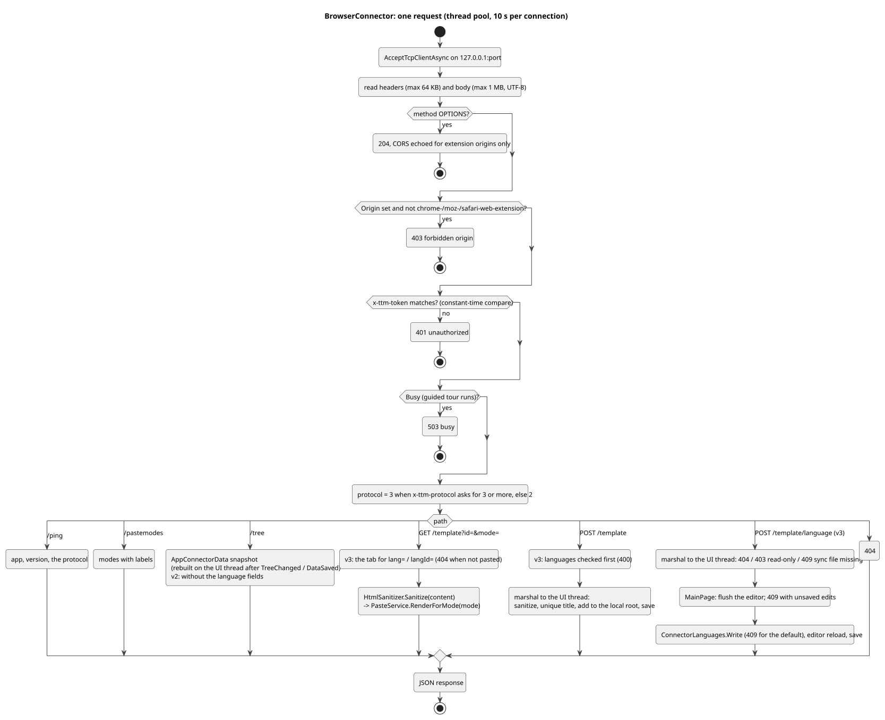

# 8. Browser connector

The connector lets the TTM-Connect browser extension list templates, fetch them rendered in a paste mode, and create templates from a page selection. The HTTP API (endpoints, payloads, errors) is documented for extension developers in [`../user/BrowserConnectorApi.md`](../user/BrowserConnectorApi.md); this page covers how it is built.

## Structure

- `BrowserConnector`: a minimal HTTP/1.1 server on `TcpListener` bound to `127.0.0.1` (not `HttpListener`, so no URL ACL reservation and no admin rights are needed). The accept loop and each connection run on the thread pool; each connection has 10 seconds from accept to reply; headers are capped at 64 KB and bodies at 1 MB.
- `IConnectorDataSource`: what the server serves. `AppConnectorData` implements it over the store; tests implement it with fixtures.
- `AppConnectorData` keeps an **immutable snapshot** of the tree (names, ids, the pasted languages with their contents, default modes), rebuilt on the UI thread whenever the store raises `TreeChanged` or `DataSaved`, and after a write. Reads from connection threads only ever see a complete snapshot. Rendering (`PasteService.RenderForMode`) is a pure function and runs off the UI thread.
- **Protocol versions.** The default is protocol 2, exactly as released. A client that sends `x-ttm-protocol: 3` (or higher) gets protocol 3: `/ping` reports 3, templates carry their languages, `GET /template` takes `lang`/`langId`, `POST /template` takes languages, and `POST /template/language` exists. For any other client `BrowserConnector` drops the language fields from the data source's replies and ignores the new parameters, so the extensions released so far (which warn on a protocol other than 1 or 2) see no change. About shows `MaxProtocolVersion`.
- **Languages** (`ConnectorLanguages`, pure and unit-tested): only pasted languages (`TemplateLanguages.Offered`) are served, the default first; codes must be ones a tab can be given in the app (`LanguageCatalog`). A new template's languages are checked before anything is added. A write adds a tab or replaces a pasted tab's text and never touches the default.
- **Writes and the editor.** `POST /template/language` runs on the UI thread through `AppConnectorData.ChangeTemplate`, which the app points at `MainPage.ChangeFromOutsideAsync`: for the template shown in the editor it first takes the editor's text (`FlushAsync`); with autosave off and unsaved edits it refuses (409), a clean draft is replaced by a fresh one; with autosave on the editor shows the change without saving its old text over it (`TemplateEditor.Reload`). The editor stays on the tab it showed. Then the store saves (a synced template through the usual sync write) and the snapshot is rebuilt.
- `App.ApplyBrowserConnectorSettings()` starts, restarts or stops the server to match the settings (off by default, port 47615, a token generated on first enable). A port that can't be used is reported at startup and in Settings > Integrations.

([source](diagrams/act-connector-request.puml))

## Security

- Bound to loopback only; nothing listens on a network interface.
- Every request must carry the pairing token in `x-ttm-token`, compared in constant time.
- CORS is answered only for extension origins (`chrome-extension://`, `moz-extension://`, `safari-web-extension://`); a request from any other web origin gets 403, so a web page can't use the connector even if it guessed the port.
- Content is sanitized by `HtmlSanitizer` in both directions: a selection sent to `POST /template` before it becomes a template, and every template before it is served (an allow-list of formatting elements and attributes, then a deny-list pass: scripts, styles, frames, objects, images and media, forms, SVG/MathML, comments, event handlers, `javascript:`/`vbscript:`/`data:` links and active CSS removed; code blocks kept as text).
- During the guided tour `Busy` is set and every authorized request is answered 503, so the extension can't see or change the sample data.
- A created template is added on the UI thread to the local root with a unique title and the default paste mode, saved, and the tree refreshed (`NotifyTreeChanged`); the request waits at most 10 seconds for that.
- A language write is refused for a template in a synced folder that is read-only (403) or whose sync file is missing (409); its content is sanitized like a created template's.

---

[← 7. Quick Paste and pasting](07-quick-paste-and-pasting.md) · [Contents](README.md) · [9. Application lifecycle →](09-lifecycle.md)
