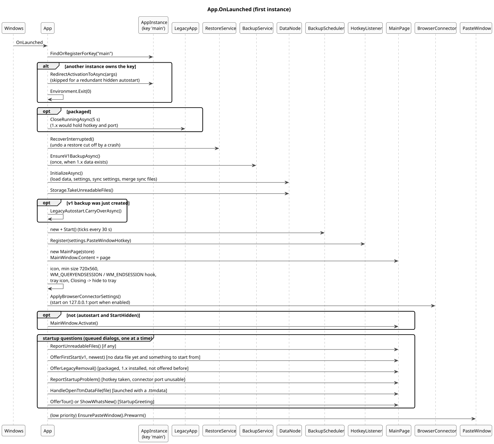
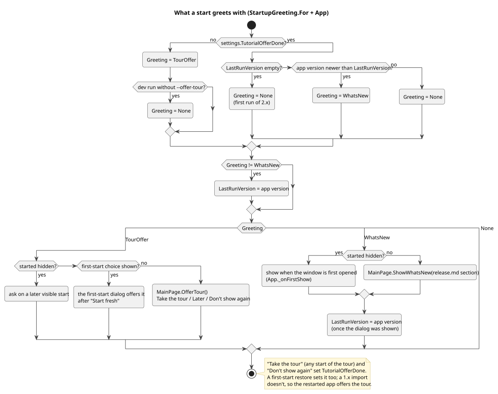
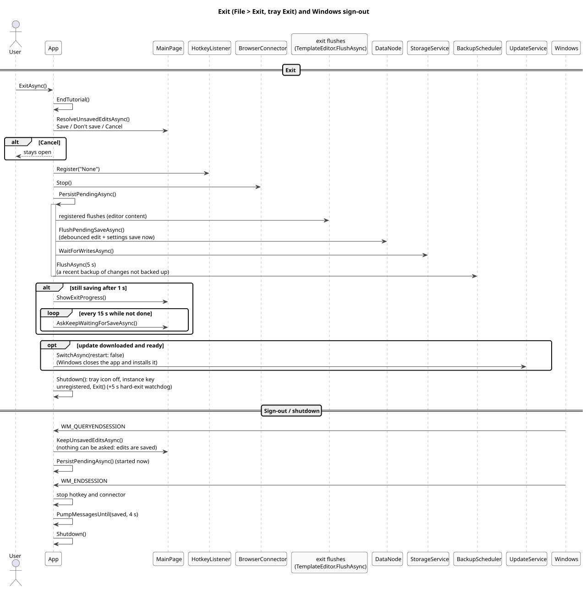

# 9. Application lifecycle

## Launch

([source](diagrams/seq-app-launch.puml))

**Language.** Before the diagram's steps, the `App` constructor reads the chosen UI language (`UiLanguages.Apply`) and sets it as the app's language override, ahead of `InitializeComponent`: the first resource lookup fixes the language for the whole run. Settings ▸ General's **Restart now** (`App.RestartAsync`) quits like Exit (unsaved edits and running downloads asked about, everything saved) and starts the app again with `AppInstance.Restart`.

**Single instance.** The app registers the `AppInstance` key `"main"`. A later launch (the Start menu, a `.ttmdata` opened from Explorer, a startup activation) redirects its activation to the running instance and exits; the running one shows its window and opens the file (`OnRedirected`). A redirect that arrives while the first instance is still starting (a second Start menu click during a slow first start; the window doesn't exist yet, and showing it crashed the app) waits in `PendingRedirects` and is applied at the end of `OnLaunched`. A redundant startup activation without a file just exits. TextTemplateManager 1 uses its own mutex and pipe, so the two versions never take over each other's launches; instead the packaged app closes a running 1.x at every start (`LegacyApp.CloseRunningAsync`), which would otherwise hold the hotkey and the connector port.

**Start hidden.** Started by Windows at sign-in (the package's startup task) with **Start hidden** on, the app stays in the tray; the hotkey and tray icon work. A `.ttmdata` to open or a file that couldn't be read shows the window anyway.

**The window's X** hides it to the tray (after the unsaved-changes question); only File > Exit or the tray's Exit quits.

## Startup questions

The startup dialogs are queued (see [6](06-main-window.md)) in this order: unreadable files, the first-start choice, removing TextTemplateManager 1, a hotkey or port that can't be used, a `.ttmdata` file to link, and finally the tour offer or What's new.

- **First start** (no `data.ttmdata` yet) with something to start from (`FirstStartOffer`: a v1 backup and/or another valid backup): Import from TextTemplateManager 1, Restore a backup, or Start fresh. Import restores the v1 backup right away, asking only about its sync files; restore opens Settings > Backups on the newest backup. Both end in a restart.
- **Removing TextTemplateManager 1** is offered once (packaged runs, 1.x uninstaller found): it runs the 1.x uninstaller silently; the 1.x data folder stays.
- **Start with Windows**: the first time 1.x data is found, 1.x's autostart and start-hidden choices carry over (`LegacyAutostart.CarryOverAsync`).

([source](diagrams/act-startup-greeting.puml))

Last, `StartUpdates` creates the updater, reads what a switch before this start left (`UpdateAttempt`) and starts its checks (see [13](13-updates.md)). After an update Windows starts the app with `--updated` (or `--updated-idle`); the window opens, and What's new shows because `LastRunVersion` is older.

What's new shows the "What's new in this release" section of `release.md`, which ships next to the exe (`WhatsNew.Parse` turns its headings, bullets and bold text into the dialog).

## Exit and sign-out

([source](diagrams/seq-exit.puml))

- **Exit** asks, while a translation language downloads (`ModelStore.Busy`), whether to wait for it, stop it (`ModelStore.StopAll`) or not exit (`MainPage.ResolveTranslationDownloadsAsync`); waiting shows a dialog that can still stop it. Then it stops new work (hotkey, connector), then `PersistPendingAsync`: the registered exit flushes (the editor's last content), the store's pending saves, all writes in flight, and a recent backup of anything not backed up yet. After 1 second a "Saving changes…" dialog shows; every 15 seconds the user can choose to stop waiting. `Shutdown()` stops the idle-install timer and the update checks (a tick after the window had closed crashed on `MainWindow.Content`), removes the tray icon, unregisters the instance key (so a new launch starts fresh instead of redirecting to the exiting process), and exits, with a 5-second hard-exit watchdog in case teardown hangs.
- **Exit with an update ready** (and automatic updates on, `UpdateService.InstallOnQuit`): after the save, the downloaded update is installed on the way out (`UpdateService.SwitchAsync` without a restart; Windows closes the app for it), so the next start is the new version. See [13](13-updates.md).
- **Windows sign-out or shutdown**: `WM_QUERYENDSESSION` starts saving at once (unsaved edits are saved, since nothing can be asked); `WM_ENDSESSION` then pumps messages for up to 4 seconds until the save is done (Windows ends the process as soon as the handler returns), and shuts down.

## Unexpected errors

`Application.UnhandledException` is marked handled and passed to `UnexpectedErrorHandler`: the error is appended to `crash.log`, everything pending is saved, and the user chooses to quit or keep running (the app may be in an inconsistent state). Async-void event handlers make this path reachable; code on dispatcher callbacks (tree refresh, timers) catches and logs its own exceptions instead.

## Restart after a restore

A successful restore (see [5](05-backups-and-restore.md)) disposes the tray icon, unregisters the instance key and calls `AppInstance.Restart`, which starts a new process on the restored files; `--offer-tour` is passed on in dev runs.

---

[← 8. Browser connector](08-browser-connector.md) · [Contents](README.md) · [10. Guided tour →](10-guided-tour.md)
