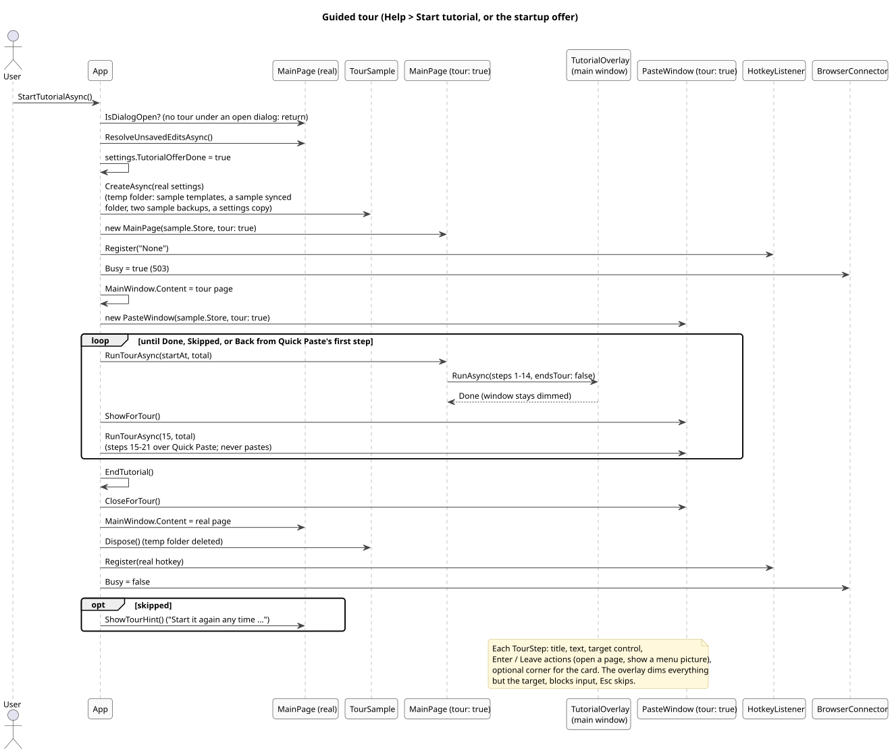

# 10. Guided tour

The tour walks through the main window, the settings and Quick Paste on sample data, without touching the user's templates or settings.

([source](diagrams/seq-tour.puml))

## Pieces

| Class | Role |
| --- | --- |
| `App.StartTutorialAsync` / `EndTutorial` | Orchestrates: sample store, page swap, input off, both parts, cleanup |
| `TourSample` | A `DataNode` over a temporary folder with sample templates (callout, code block, tags, single and multi keys), a sample synced folder (its own temp sync file), two sample backups for the Backups page, and a copy of the real settings (so the tour shows the user's own hotkey). `Dispose` deletes the folder. |
| `MainPage(store, tour: true)` | A second main page over the sample store; its view model's sync polling is stopped at the end |
| `PasteWindow(store, tour: true)` | Quick Paste over the sample store that never pastes and takes no keys; closing it ends the tour |
| `TutorialOverlay` | Dims the window except a cutout around the step's target, places the card beside the target (right, left, below, above, sliding along the side) or in a fixed corner, blocks all input except the card; Esc skips. Between the two parts the main window stays dimmed. |
| `TourStep` | Title, text, target control, `Enter` and `Leave` actions (open a settings page, select an item, show a picture of a menu), optional corner |
| `MainPage.Tour.cs`, `PasteWindow.Tour.cs` | The steps of each part (14 + 7) |

## Input while the tour runs

- The global hotkey is switched off (`Register("None")`) and restored at the end.
- The browser connector answers 503 (`Busy`).
- The real main page is swapped out, so nothing the user does can reach the real store; the overlay blocks the sample page too.
- Menus are shown as a picture built from the real menu items (`ShowExtra`), because an open `MenuFlyout` would swallow the next click on the card.

## Offer and versions

Starting the tour (from the offer or from Help) sets `TutorialOfferDone`; see [9](09-lifecycle.md) for when the tour is offered and when What's new shows instead.

When a feature or a window changes, the tour steps, texts, targets and sample data are updated in the same change.
