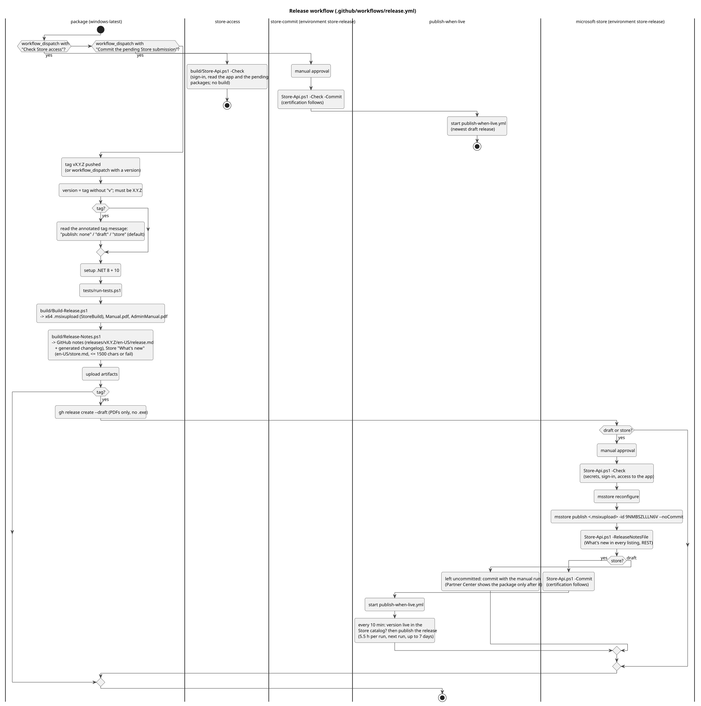

# 11. Platform, build and release

## Packaged and dev runs

`AppEnvironment.Detect()` checks for a package identity and returns one of two `IAppEnvironment`s; everything that differs between the Store package and a dev run from `bin\` goes through it.

| | Packaged (Store) | Unpackaged (dev run) |
| --- | --- | --- |
| Data folder | Package `LocalState` | `%LocalAppData%\Marflow Software\TextTemplateManager 2 Dev` |
| Backups | `Documents\TextTemplateManager\Backups` | `Documents\TextTemplateManager\Backups (Dev)` |
| Start with Windows | Startup task `TtmStartup` (Windows Settings > Apps > Startup) | Not available |
| Started at sign-in | Startup-task activation | `--hidden` stands in for it |
| Opened file | File activation | First `.ttmdata` command-line argument |
| Closing a running 1.x, removal offer | Yes | No (a dev run leaves an installed 1.x alone) |
| Tour offer at startup | Yes | Only with `--offer-tour` (UI test scripts start on fresh data) |

`TTM_DATA_DIR` overrides the data folder in both (then backups and the 1.x folder are looked for inside it). The test suite sets it for every test, and UI checks run with it, so no test ever touches real data. The 1.x data folder (`%LocalAppData%\Marflow Software\TextTemplateManager`) is only ever read.

## Package manifest

`src/TextTemplateManager/Package.appxmanifest`: identity `MarflowSoftware.TextTemplateManager` with the Partner Center publisher, display name TextTemplateManager, `runFullTrust`, a startup task (`TtmStartup`, enabled), the `.ttmdata` file type association, minimum Windows 10 2004 (19041). The version is stamped from the build (`-p:Version=X.Y.Z` becomes `X.Y.Z.0`).

## Build

| Build | Command | Result |
| --- | --- | --- |
| Dev | `dotnet build src\TextTemplateManager\TextTemplateManager.csproj -c Debug -p:Platform=x64` | Unpackaged `ttm2.exe` in `bin\x64\Debug\...\win-x64` |
| Tests | `pwsh -File tests/run-tests.ps1` | Builds the app unpackaged and self-contained, then runs xUnit |
| Store | `build/Build-Release.ps1 -Version X.Y.Z` (from a short path) | `TextTemplateManager_X.Y.Z.0_x64_bundle.msixupload` (`-p:StoreBuild=true`), manual PDFs |

The project is unpackaged by default (`WindowsPackageType=None`); `StoreBuild=true` switches to MSIX with the Windows App SDK as a framework dependency and an unsigned bundle (the Store signs it). The XAML compiler fails silently near 260-character paths, so release builds run from a short path. The editor bundle under `Assets/editor` is committed, so the app builds without Node; after changing `src/editor`, run `npm run build` there. `Manual.pdf` is generated from `docs/user/Manual.md` by `tools/ManualGen` during the build. The icon and tile PNGs and `AppIcon.ico` under `Assets` are committed too; they are rendered from `design/logo/logo.svg` by `design/logo/Render-Assets.ps1` (ImageMagick), so after changing the logo run that script.

## Release

([source](diagrams/act-release.puml))

The git tag is the only version source. How to publish, the secrets and their renewal are in [`../PUBLISHING.md`](../PUBLISHING.md); `release.md` is the release-notes template (its "What's new" section is also the in-app What's new); `store.md` holds the Store texts, its "What's new" block is sent with the submission.
