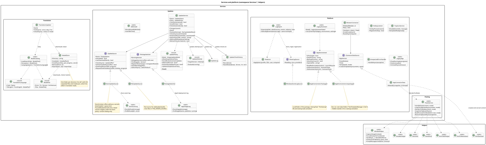
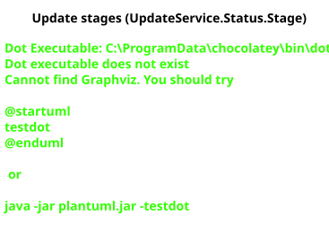
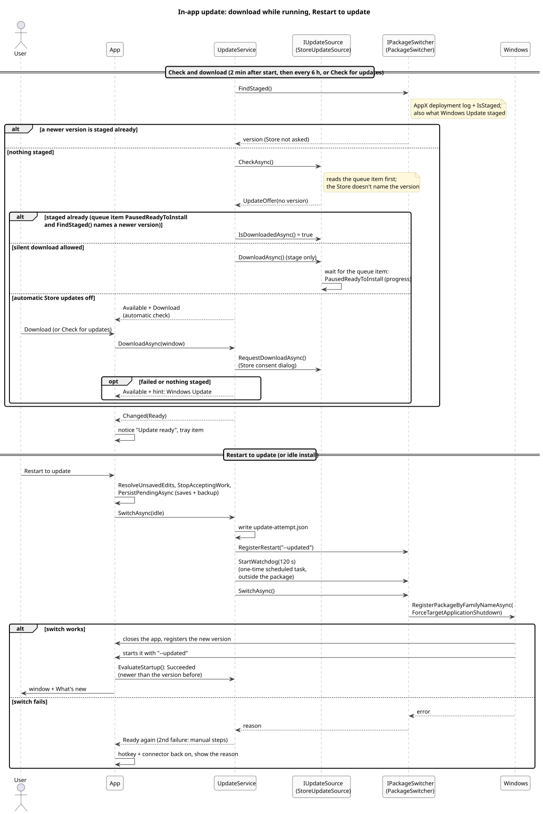

# 13. In-app updates

The Store package updates itself from the Microsoft Store, but Windows can't switch a running app to a new version: its own updater downloads and stages the update, then fails with `0x80073D02` while the app runs, and doesn't retry when it closes. TextTemplateManager runs in the tray all day, so it triggers the switch itself. Everything lives in `Services/Updates`; the UI parts are `MainPage.Updates.cs` (the notice), the Updates section of `GeneralSettingsPage` and the tray menu.

## How Windows behaves (measured)

Measured on the developer's PCs with the Store package and on a test VM with sideloaded packages (October 2026):

- An update is **staged** (downloaded next to the installed version), then **registered** (the switch). Only the register needs the app closed.
- Registering the staged package by family name with `ForceTargetApplicationShutdown` makes Windows close the app, switch, and, when the app called `RegisterApplicationRestart`, start the new version right away with the given command line. No helper and no extra capability are needed.
- A failed register leaves the update waiting; the next start **from the shell** (Start menu, logon task) with the app closed applies it. `AppInstance.Restart` doesn't.
- `uap17:UpdateWhileInUse="defer"` doesn't queue anything: it only makes Windows ignore force-close requests, so it isn't used.

## Classes

- **`UpdateService`**: the updater's logic and state (`UpdateStatus`, `UpdateStage`), free of UI types so the tests drive it with stand-ins. Checks two minutes after the start and every six hours, downloads right away when the source allows it, and runs the switch. With the user's **Check for and download updates automatically** off (`AppSettings.NoAutomaticUpdates`, `UpdateService.CheckAutomatically`) only **Check for updates** checks, and there is no idle install and no install on quit (`InstallOnQuit`). `Changed` may fire on any thread; `App` marshals it to the UI.
- **`IUpdateSource`**: where updates come from. `StoreUpdateSource` uses `StoreContext` (`GetAppAndOptionalStorePackageUpdatesAsync`, `TrySilentDownloadStorePackageUpdatesAsync` to stage without installing, `RequestDownloadStorePackageUpdatesAsync` for the Store's consent dialog). `FileUpdateSource` is the test source for sideloaded builds: the newest `.msix` of the app in the folder `TTM_UPDATE_SOURCE` names, staged with `PackageManager.StagePackageAsync`; a file `consent-only` in that folder makes it behave like a Store under the "no automatic updates" policy. The Store package never uses it.
- **`IPackageSwitcher`** / **`PackageSwitcher`**: `IsStaged` (the staged package's folder next to the installed one), `RegisterRestart` (`RegisterApplicationRestart` with no-crash/no-hang/no-reboot flags, so only an update restarts the app), `StartWatchdog`, `SwitchAsync` (the forced register).
- **`UpdatePolicy`**: `HKLM\SOFTWARE\Policies\Marflow Software\TextTemplateManager` (`InAppUpdates` 0/1/2, `AllowUpdateDespiteStorePolicy`, `AutomaticUpdates`, `IdleInstall`) and the Store's `AutoDownload` = 4. The policy is read again before every check and, through `UpdateService.RefreshPolicyForSwitch`, right before every switch (Restart to update, idle install, quit), so a policy set while an update is ready takes the ready state away. With `InAppUpdates` = 1 an update Windows has already staged stays a notice. `AutomaticUpdates` 0/1 overrides the user's automatic-updates switch (`UpdateService.ChecksAutomatically`). `OptInDespiteStorePolicyOffered`: the Store policy is on and the administrator allows the user's **Keep updating when automatic Store updates are off** (`AppSettings.KeepUpdatingDespiteStorePolicy`, `UpdateService.KeepUpdatingDespiteStorePolicy`); then `UpdateService` downloads through `IUpdateSource.DownloadDespitePolicyAsync` on its own.
- **`UpdateAttempt`**: `update-attempt.json` in the data folder, written right before a switch; the next start compares the running version with it (`EvaluateStartup`). After two failed tries for one version only the manual steps are shown.
- **`UpdateLog`**: `update.log` next to the crash log, every step, trimmed at 256 KB.
- **`IdleInstall`**: when idle install may switch (`ShouldInstall`) and the time since the last input.

## Stages

The notice above the panes (`UpdateBar`) shows Downloading (with progress), Ready (**Restart to update**), Available with **Download** (automatic Store updates are off: the Store's consent dialog; where the policy allows the opt-in, the notice points to it), Available without a button (notice-only policy, or the Store policy without the admin's permission), Failed (**Try again**) and the manual steps. Closing it hides it until the stage or version changes. The tray menu has Restart to update while an update is ready, and a tray notice says so once per version when the window is hidden.

## The switch

`App.InstallUpdateAsync` handles unsaved edits like a quit (Restart to update only; the idle install runs only without them), stops the hotkey and the connector, and runs `PersistPendingAsync` (pending saves, registered flushes, a recent backup). `UpdateService.SwitchAsync` then writes the attempt, registers the restart (`--updated`, or `--updated-idle` for the idle install), starts the watchdog and calls the forced register. On success the process is ended by Windows; when the call returns, the switch didn't happen, the app turns its input back on and shows the reason.

- **Watchdog**: a one-time task in the user's Task Scheduler (`TextTemplateManager update watchdog`, from `update-watchdog.xml` and `update-watchdog.ps1` in the data folder). Two minutes after the switch (Windows' own restart took 10 to 110 seconds on the test VM) it starts the app through the shell if it isn't running, which also applies a switch still waiting, notes what it did in `update.log` and deletes itself. A scheduled task runs outside the package; a child process started with the desktop-app breakaway attribute was still ended with the app at the switch on the test VM.
- **60 seconds**: `RegisterApplicationRestart` only takes effect once the process has run for 60 seconds, so `InstallUpdateAsync` waits until it has run 65.
- **Restart arguments**: `--updated` opens the window, and What's new shows as after any update (`StartupGreeting`). `--updated-idle` (idle install) does the same; it only tells the two apart in the log.
- **Quitting with an update ready** (`ExitAsync`, only with automatic updates on) switches without a restart (`UnregisterApplicationRestart` first), so the next start is the new version.

## Idle install

A dispatcher timer checks every minute: update ready, allowed (user setting `IdleInstall`, off by default and only with automatic updates on, unless the `IdleInstall` or `InAppUpdates` policy decides), window and Quick Paste hidden, nothing unsaved, no dialog or tour, ten minutes without input in the session, and the process running for at least two minutes (`RegisterApplicationRestart` needs 60 seconds).

## Not covered yet

- The Store route can only be tested with a real Store release: the first release with the updater is the one later releases update from.
- The route around the Store policy (`DownloadDespitePolicyAsync`: winget's msstore source, a user-started install through the Store's install service) isn't tested against a real Store release yet. winget downloads and stages; its install step either fails while the app runs (the app then switches itself as usual) or closes the app, which `RegisterApplicationRestart` (armed before winget runs) brings back.

---

[← 12. Testing](12-testing.md) · [Contents](README.md)
