## Introduction

TextTemplateManager is a Windows application for storing reusable pieces of text — email
replies, code snippets, standard responses, boilerplate — and inserting them into any other 
application with a keystroke. Templates are organized in folders, can be given keyboard-
shortcuts, and can optionally be shared with a team through a synchronized file.

This manual describes every feature of the application. Throughout, a menu path is written in
the form **Menu ▸ Item** (for example, **Settings ▸ General**), and keyboard input is shown in
bold (for example, **Alt**). The installed version is shown under **Help ▸ About**.

### Installing

Install TextTemplateManager from the Microsoft Store: search for *TextTemplateManager* in the Store app, or open [its Store page](https://apps.microsoft.com/detail/9NMBSZLLLN6V). The Store also keeps it up to date (see *Updates*). The .NET runtime is part of the app and the Store adds the Windows App SDK it needs, so nothing else has to be installed, and no administrator rights are needed. In a company, IT may install it for you instead (see the **Administrator & Deployment Guide**).

Coming from TextTemplateManager 1: its templates and settings stay where they are. Version 2 backs them up at its first start and offers to import them (see below), and it closes a version 1 that is still running, so the two don't compete for the Quick Paste shortcut.

### The first start

When the application starts without any templates yet and finds something to start from, it asks how you'd like to start:

- **Import from TextTemplateManager 1**, if version 1 was used on this PC: its templates, settings and sync settings, taken from the backup made of them (see *Automatic backups*). They are imported right away; you're only asked about linked sync files that are missing (recreate it there from the backup's copy, link another file, or leave it missing). An existing shared sync file is linked as it is, never overwritten. Then the app restarts. To take over only some parts, choose **Start fresh**, then pick the "From TextTemplateManager v1" backup in **Settings ▸ Backups**, untick what you don't want and click **Restore…**.
- **Restore a backup**, if backups from an earlier installation are in your Documents folder: **Settings ▸ Backups** opens with the newest one selected.
- **Start fresh**: an empty tree. You won't be asked again; importing or restoring is still possible in **Settings ▸ Backups**.

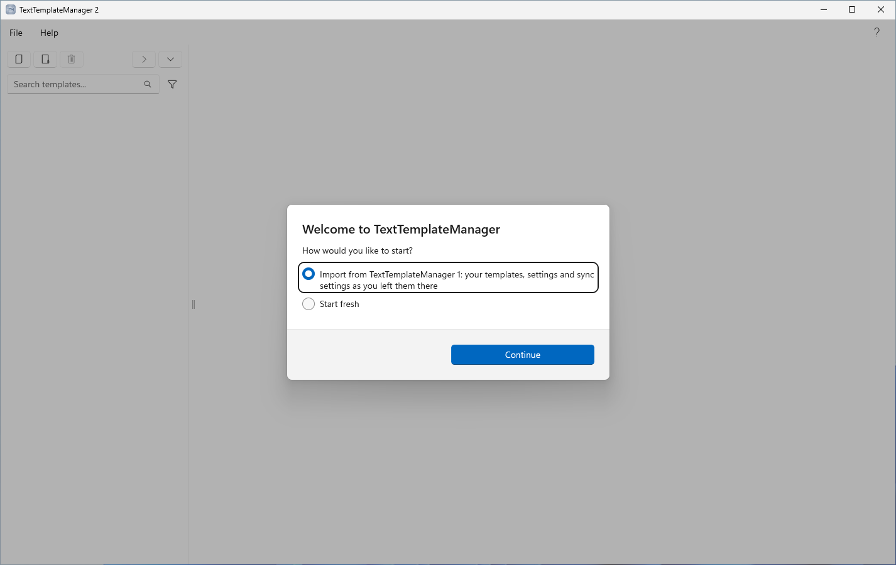

If TextTemplateManager 1 is still installed, you're also asked once whether to remove it. **Remove TextTemplateManager 1** runs its own uninstaller; its data folder stays on this PC. If it can't be removed from here, remove it in Windows **Settings ▸ Apps ▸ Installed apps**.

### The guided tour

**Help ▸ Start tutorial** walks you through the main window, the settings and Quick Paste step by step: each step highlights a part of the window and explains it on a card beside it. The tour uses sample templates, so your own templates and settings are never changed; while it runs, the window can't be used and the Quick Paste shortcut and the browser connector are paused. For its last part the tour opens Quick Paste itself; there it never pastes anything. **Next** and **Back** move between the steps, and **Skip tutorial**, the close button or **Esc** end the tour at any time.

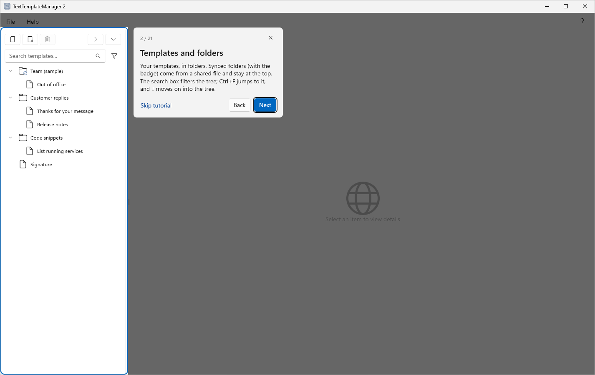

When you start TextTemplateManager the first time, it offers the tour: right after **Start fresh**, or after the restart when you import from TextTemplateManager 1. **Take the tour** starts it, **Later** (or **Esc**) asks again on the next start, and **Don't show again** stops the offer. Once you've started the tour, from the offer or from the Help menu, it isn't offered again. If you restore a backup on the first start, the tour isn't offered; you can still start it from the Help menu.

### What's new

After an update, the first time the window opens it shows what's new in that version, once. Close it with the **X** in its corner or **Esc**.

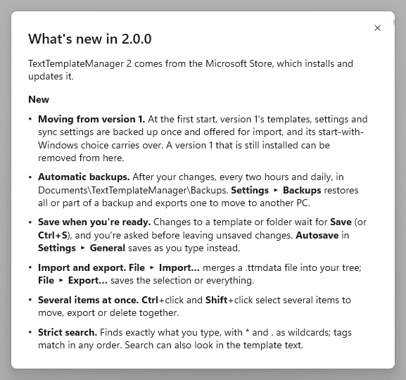

---

## The main window

The main window is divided into two panes:

- The **left pane** contains the template tree and a search box. The tree holds your folders and 
  templates, including any synchronized folders, which are pinned to the top.
- The **right pane** shows the editor for the currently selected template, or the title field for 
  a selected folder. When nothing is selected, it shows a placeholder.

The toolbar above the tree provides buttons to add a template, add a folder, and delete the 
selected item, and on its right two buttons to collapse and expand all folders at once. The menu bar provides the **File** and **Help** menus, and the quick-help button
in the top-right corner opens a short in-app reference.

---

## Templates and folders

### Creating items

Use the toolbar to add a new template or folder. New items are placed relative to the current 
selection: inside the selected folder, alongside a selected template, or at the top level when 
nothing is selected. New items are given a unique default name, which you can change at any time.

### Organizing the tree

Drag items to reorder them or to move them between folders. Folders may contain both templates and other folders; a template is always a leaf and can never contain other items. Where an item lands depends on where you drop it: on the upper half of a template it goes above, on the lower half below. On a folder, the middle drops it into the folder, the top or bottom edge beside it; just below an expanded folder it goes to the top of that folder's contents. Dropping on the empty space below the tree moves it to the end of the top level. Expansion and selection are preserved as you work.

To move an item out to the top level, drag it there, for example onto the empty space below the tree.
Click an empty area of the tree to clear the selection — with nothing selected, new templates and folders are created at the root. From the keyboard, **Esc** steps back one level at a time: from the tree to the search box, then it clears the search text, and with the search box already empty it clears the selection.

To work on several items at once, select them as in File Explorer: **Ctrl**+click adds or removes an item, **Shift**+click selects all visible rows between the last clicked item and this one. From the keyboard, **Shift + ↑ / ↓** extends the selection row by row and **Ctrl + A** selects all visible rows. The editor shows the last clicked item. Dragging one of the selected items moves all of them together (they keep their order); if one of them can't go there, nothing moves. **Delete** (key, toolbar button, or right-click on one of the selected items) deletes them all after one confirmation; **File ▸ Export…** or **Export … items** in the right-click menu saves them into one `.ttmdata` file (see *Backup and export*). Synced folders themselves and items in read-only synced folders are never deleted this way. Typing in the search box starts the selection over from the last clicked item.

The search box filters the tree: every word you type must appear in an item's title or tags, in any order, and a word's letters only need to appear in order, not next to each other (`mtg` finds *Meeting*). Folders holding a match stay visible and open. To look inside the templates' text as well, open the filter button beside the search box and turn on **Search template text**; a dot on the button shows it is on. It stays on until you turn it off, in both the main window and Quick Paste.

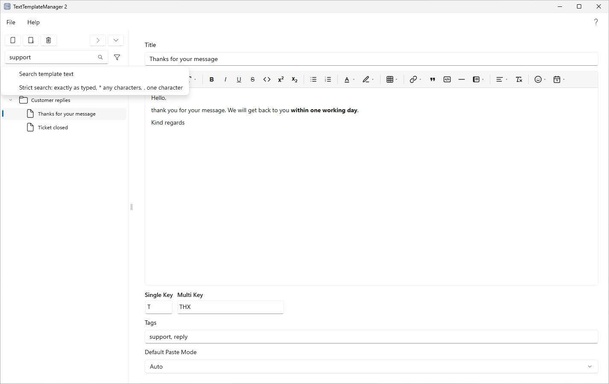

For an exact search, turn on **Strict search** on the same button. The search box then finds exactly what you type, anywhere in an item's title, its tags or (with **Search template text**) its text: several words as one phrase in the order typed, without the letter skipping of the normal search; upper and lower case don't matter. `lunch` finds *A lunch order*, and so does `unch ord`, but `lunch today` doesn't find *Lunch order for today*. Tags are the exception: there the words may come in any order, each one found in one of the tags, so `billing support` finds a template tagged *support, billing*. `*` stands for any characters (also none) and `.` for exactly one character, so `invoice * reminder` finds *Invoice payment reminder*, and `colo.r` finds *Colour* but not *Color*. To search for a `*` or `.` itself, put a backslash before it (`v2\.0`).

From the search box, **↓** moves into the tree, the same way as in Quick Paste: if the text cursor isn't at the end yet, the first **↓** moves it there.

### The template editor

Selecting a template opens it in the editor, which supports bold, italic, underline, 
strikethrough, text and highlight colors, headings, bulleted and numbered lists, links, tables, 
callout panels, and code blocks with syntax highlighting.

The toolbar works from the keyboard too. It is one stop of the main window's **Tab** order: the arrow keys (**←** / **→**, **Home**, **End**) move along its buttons, **Enter** opens a button's menu (text and highlight colors, table, alignment, symbols, translation) and **Tab** moves into it, **Esc** closes the menu again. **Tab** from the toolbar goes into the text, with the cursor at the end. In the text, **Tab** nests a list item (**Shift + Tab** moves it back out), moves to the next table cell and indents a line in a code block (**Shift + Tab** takes the indent off again); anywhere else **Tab** moves on to the template's shortcuts and **Shift + Tab** goes back to the toolbar. **Ctrl + Tab** always moves on. In the table menu, the arrow keys choose the number of rows and columns and **Enter** inserts the table.

Changes to a template or folder (its title, text, tags, shortcuts and default paste mode) wait for you to save them: a **Save** button appears in the top-right corner, next to the help button, and **Ctrl+S** saves too, also while typing in the editor. If you select another item, close the window or exit while changes aren't saved, you're asked whether to **Save** them, **Don't save** them (the item goes back to how it was last saved), or **Cancel** (you stay on the item, changes kept, and the window stays open). A brief **Saved** indicator appears each time your data is written. To save as you type instead, switch on **Autosave** in **Settings ▸ General**. Adding, deleting, moving and importing items are always saved at once.

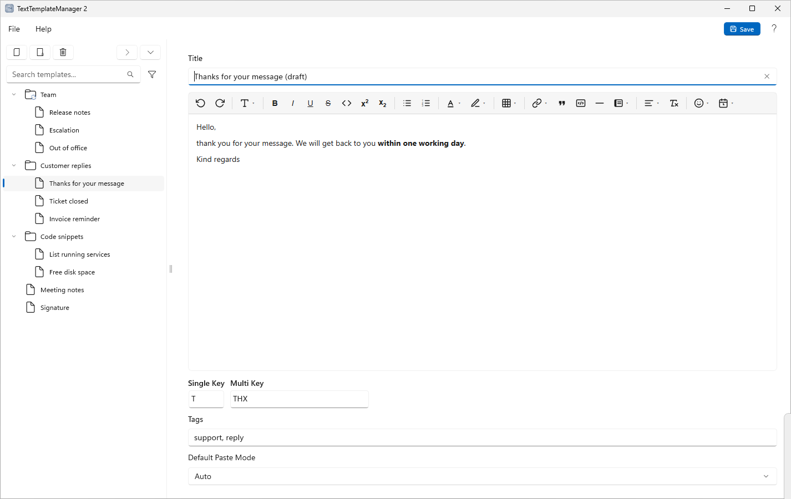

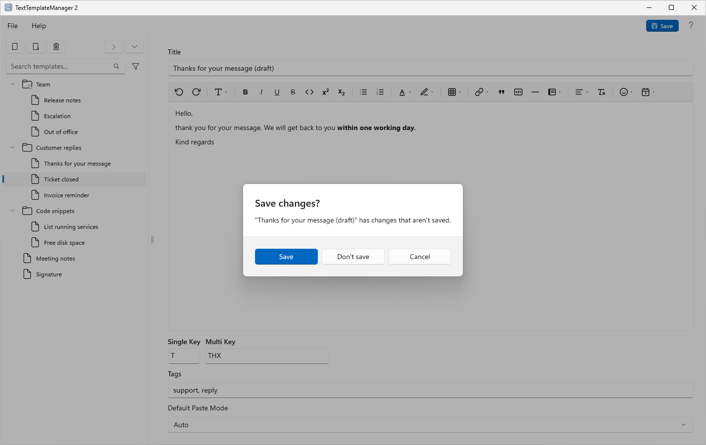

**Ctrl+click** a link to open it in your default browser, and hover over a link to see where it 
points. A plain click just places the cursor so you can edit the link.

.png>)

### Code blocks

The **Code block** button on the toolbar formats the current block as monospaced code with a 
line-number gutter (the **Preformat** entry in the text-format menu is the same style without the 
numbers). A picker in the block's top-right corner sets the language: it **auto-detects** by 
default, or you can choose PowerShell, Python, Batch/cmd, Bash, JSON, JavaScript, TypeScript, 
HTML/XML, SQL, C#, YAML, Markdown, or **Plain text** to turn colouring off. Colours follow the 
light/dark theme and also appear in the read-only preview; the template itself still stores plain 
text.

Long lines wrap to the next row instead of scrolling sideways, with the line numbers staying 
aligned. Typing is indentation-aware: **Enter** keeps the current indentation and steps in after 
an opening `(`, `[`, `{` or a backtick, while typing a closing `)`, `]` or `}` steps back out, and 
pasting multi-line code re-indents it to fit where you drop it.

### Callout panels

The **Panel** button on the editor toolbar wraps the current block in a colored callout, in one 
of five styles: **Info**, **Note**, **Success**, **Warning**, or **Error**. Choosing the panel's 
current style again removes the panel; choosing a different style changes it.

To move the cursor out of a panel, press **↓** or **→** at the end of its last line, or press 
**Enter** on an empty last line (a first **Enter** adds a line inside the panel, a second steps 
out) — the same way code blocks behave.

Panels adapt to whichever paste mode you use (see *Paste modes*): they become native panels in 
Atlassian Jira, colored boxes in email and word processors, and a labeled quote in Markdown.

### Translating a template

The **Translate** button at the right end of the editor toolbar translates a template on this PC; the text isn't sent anywhere. It needs at least one language from **Settings ▸ Translation** (see *Translation* under *Settings*); until one is installed, its menu only offers **Download languages…**. Translation is experimental.

In the menu, choose the language the template is written in under **From** and the language to translate it to under **To**. **Detect** guesses the language from the text and shows its guess, for example *Detect (English)*; for a short text it can't tell, and the menu asks you to choose. Both choices are remembered.

- **Replace template** replaces the template's text with the translation. **Ctrl+Z** brings the original back.
- **Create new template** leaves this template as it is and adds a translated copy next to it, which is then selected. The copy's title gets the language in brackets (*Not reachable* becomes *Not reachable (DE)*) and its Multi Key shortcut gets the language code (*NOTREACH* becomes *NOTREACHDE*); its tags and default paste mode are copied, and its Single Key shortcut is left empty. Translating such a copy again replaces the language instead of adding a second one (*Not reachable (DE)* to English becomes *Not reachable (EN)*).
- **Replace selection**, shown when text is selected, translates only the selection.

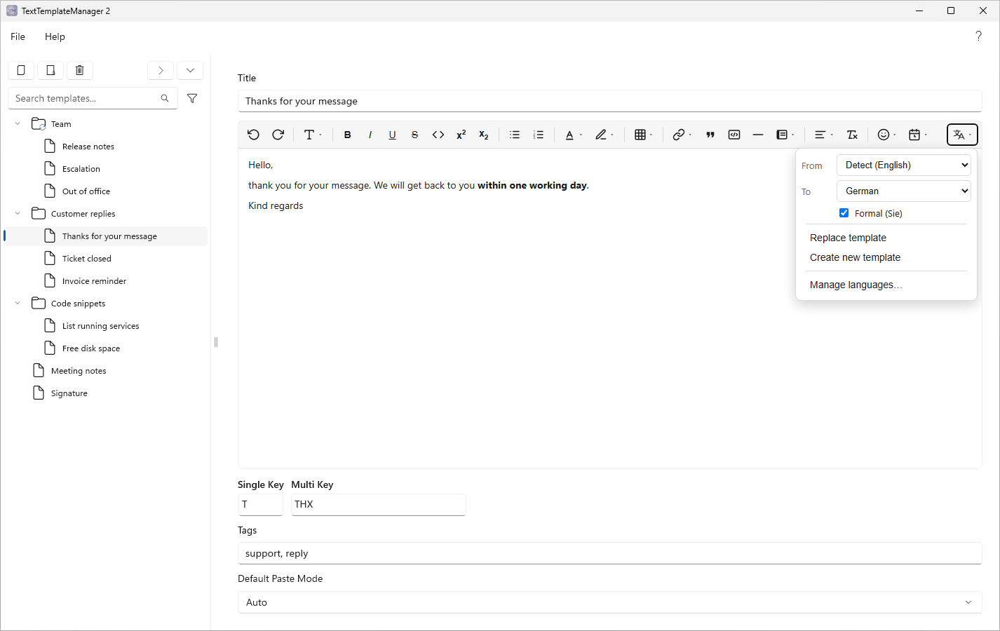

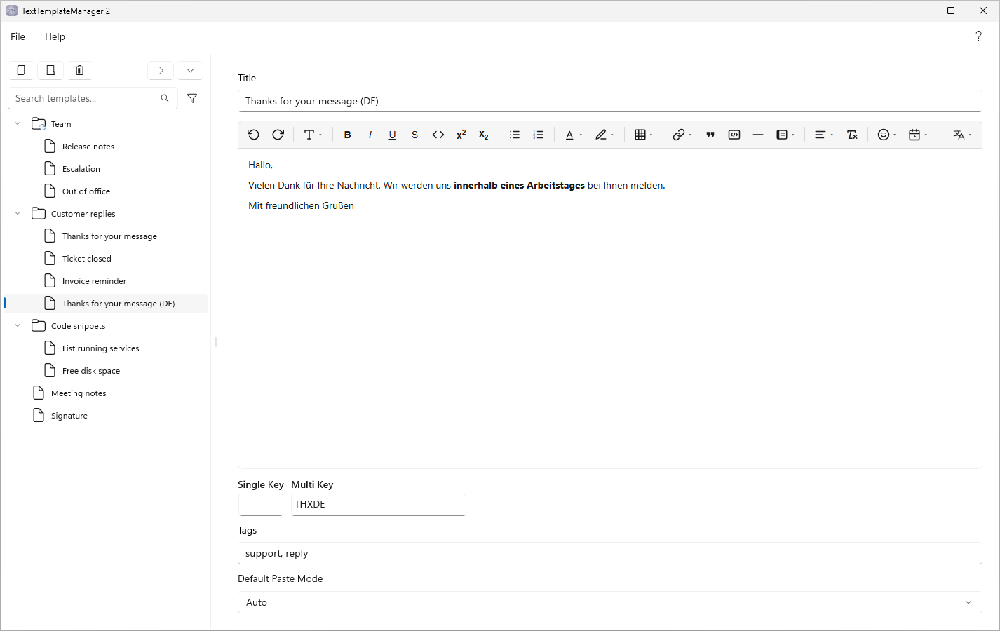

With German under **To**, **Formal (Sie)** chooses how the reader is addressed. On, lines that came out with *du* are translated again to use *Sie*; this catches nearly all of them. Off, lines that came out with *Sie* are translated again to use the informal *du*; this is best effort and works for only about half of the sentences, since the language models strongly prefer *Sie*, so an informal translation can mix *du* and *Sie*. The menu says so while Formal is off.

Formatting, links and date and time placeholders such as `$[DATE]` are kept. Each language translates to and from English; between two other languages, for example German and French, the text goes through English, so both need to be installed.

Machine translation makes mistakes: it can change the meaning, leave out words, or put a link or formatting on the wrong words. Read every translation before you use it.

### Template properties

Each template exposes the following properties:

- **Title** — the display name, shown in the tree and searchable.
- **Tags** — optional, comma-separated keywords that are also included in search.
- **Default paste mode** — the format used when the template is pasted (see below).
- **Single-key shortcut** and **Multi-key shortcut** — optional shortcuts for the Quick Paste window (see *Keyboard shortcuts and conflicts*). Shortcuts consist of letters and digits only; `-` and `.` are reserved as the separator between a synced folder's prefix and its shortcuts.

### Paste modes

The paste mode determines how a template is placed on the clipboard and inserted into the target 
application:

The modes are listed below in the order they appear in the app.

| Mode | Description |
| --- | --- |
| Auto | Chooses the most suitable format for the target application — the most broadly compatible choice. Callout panels render as colored boxes. |
| HTML/Jira | HTML tuned for Atlassian Jira: callout panels and text colors are preserved so Jira's comment editor rebuilds them natively (colors snap to Jira's nearest palette color). |
| HTML | HTML markup. Callout panels are rendered as colored boxes, for broad compatibility with email clients, word processors, and web apps. |
| RTF | Rich Text Format. Callout panels are rendered as shaded, bordered boxes. |
| Markdown | Markdown source text. Callout panels become a labeled blockquote. |
| Plaintext | Unformatted text only. |

---

## Quick Paste

Quick Paste is a compact window that lets you insert a template into whichever application you 
were using, without leaving the keyboard.

Press the configured global hotkey (see **Settings ▸ General**) from any application to open it.
Quick Paste remembers the application you came from and returns focus to it when a template is 
pasted.

> **Remote Desktop (RDP):** If TextTemplateManager is running on both your local computer and a 
> remote computer you connect to over RDP, the global hotkey always opens Quick Paste on the 
> **local** computer — Windows delivers a registered global hotkey locally, so it never reaches the 
> remote session. Give each machine a **different** hotkey (in **Settings ▸ General**), or run only 
> one instance, to avoid the clash.

### Inserting a template

- **Single-key shortcut** — Quick Paste opens ready for shortcuts (the search box isn't focused), so 
  just press the key assigned to a template to paste it immediately. If the same key is assigned in 
  more than one area, the local template takes precedence, followed by synchronized folders in their 
  configured order. You can also browse the list with the **↑ / ↓** arrow keys and press **Enter** to 
  paste the highlighted row. A letter or digit with no template assigned sounds a short error tone 
  rather than doing anything — the keyboard here is for shortcuts, so pressing **Tab** (or clicking) is 
  how you move to the search box. (Once the search box has focus, letters filter instead of triggering 
  shortcuts — see *Search*.)
- **Multi-key shortcut** — hold **Alt** and type the shortcut. The list narrows as you type and 
  highlights the top match; **release Alt** to paste it. You don't have to type the whole 
  shortcut — a partial entry pastes the highlighted match. Use **↑ / ↓** while holding **Alt** to 
  move the highlight (this doesn't change what you've typed), and press **Enter** to paste the 
  highlighted row even before typing anything. If you type and then delete everything, releasing 
  **Alt** pastes nothing. Shortcuts in synchronized folders carry the folder's prefix (for 
  example, `AND-MSG`); the separator is `-`, `.` or *none* (set in **Settings ▸ Sync**). Press 
  **Backspace** while holding **Alt** to correct a mistyped entry.
- **Paste as plain text** — while still holding **Alt**, end a multi-key entry with **Shift + -** (which produces `_`) to 
  insert the template as unformatted text, regardless of its default paste mode.
- **Search** — click the search box (or press **Tab** or **Ctrl + F**) to filter the tree and the shortcut lists, matched the same way as in the main window (including **Search template text** and **Strict search**, which the filter button here turns on and off too); matching templates display 
  their folder path. While the search box has focus, every letter filters and never triggers a 
  shortcut; press **Esc** to return to shortcut mode. In the search box the arrow keys move the text 
  cursor — **↑** to the start, **↓** to the end — and pressing **↓** again once the cursor is at the 
  end (or the box is empty) moves into the template tree, the same as **Tab**. From the tree, **Esc** 
  returns to the search box with your text intact, and typing a letter carries straight on filtering. 
  Double-click any template, in either the tree or the shortcut lists, to paste it.

The shortcut lists at the bottom of the window show the available single-key and multi-key 
shortcuts, together with the area each belongs to (a synchronized folder's name, or *local*). 
Switch between them with the **Single Key** and **Multi Key** tabs.

Whichever tab is showing, its first row is highlighted, **↑ / ↓** move the highlight, and **Enter** 
pastes it — so the Multi Key list can be browsed with the mouse and keyboard without holding **Alt**. 
(This applies in shortcut mode, when neither the search box nor the tree has focus; the arrows do 
something different in each of those, as described above.) The arrow keys wrap around: pressing **↓** 
on the last row returns to the first, and **↑** on the first row jumps to the last.

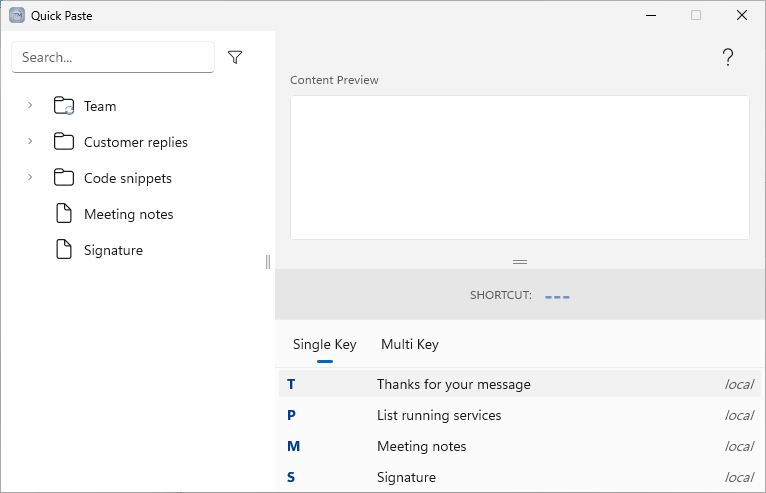

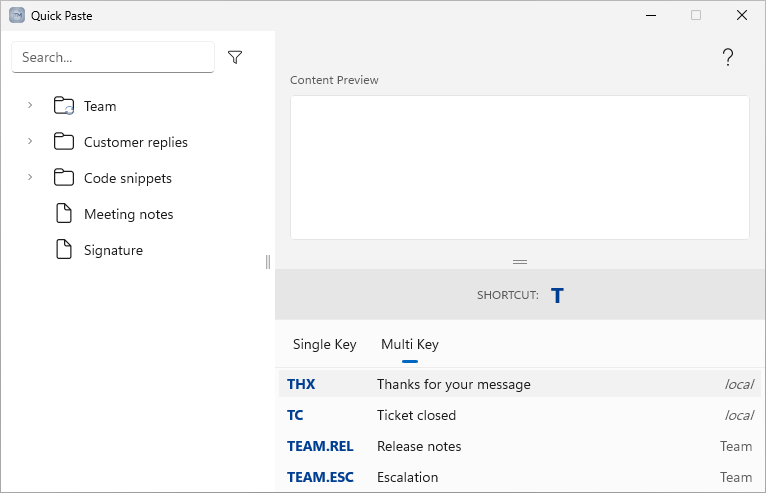

To paste with a format other than the template's default just this once, right-click it (in the 
tree or a shortcut list) and choose **Paste As**:

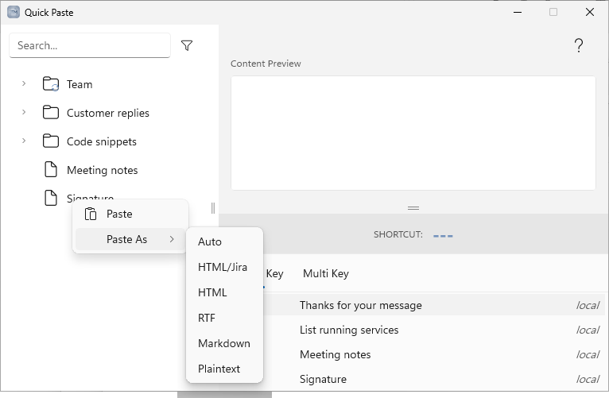

---

## Keyboard shortcuts and conflicts

Every shortcut belongs to an **area**. An area is either a specific synchronized folder or the 
set of everything outside synchronization (referred to as *local*).

- A **single-key** shortcut may be reused in different areas. When a key is assigned in more than 
  one area, Quick Paste resolves it by priority: the local template first, then synchronized 
  folders in the order configured in settings. Assigning the same single key twice **within the 
  same area** is a conflict and is not permitted; the application reports it and does not save the 
  duplicate.
- A **multi-key** shortcut is compared on its *effective* form — a synchronized folder's prefix and 
  separator are folded in first (so `MSG` in a folder prefixed `AND` becomes `AND-MSG`), which keeps 
  otherwise-identical shortcuts in differently-prefixed folders apart. When two areas do resolve to 
  the **same** effective shortcut — for example a local `ANDMSG` and a folder prefixed `AND` with the 
  separator set to *none* holding `MSG` — it is treated just like a single-key cross-area duplicate: 
  allowed, resolved local-first then sync order. A duplicate **within one area** is a conflict and is 
  not saved.

Cross-area duplicates (single- or multi-key) are permitted and are shown as an informational note 
rather than an error. When you move a template into an area that already uses its shortcut, the 
application resolves the clash automatically: a duplicate single-key shortcut is removed from the 
moved template, and a duplicate multi-key shortcut receives a numeric suffix (for example, `MSG` 
becomes `MSG1`).

Any outstanding conflicts and notes are listed in a small panel in the top-right of the main 
window. Same-area conflicts must be resolved, so the panel stays until they are; a panel showing 
only cross-area notes can be dismissed with its **×** button, or hidden entirely with **Hide 
cross-area shortcut warnings** in **Settings ▸ General**.

---

## Settings

Open settings from **File ▸ Settings**. It has a **General**, an **Integrations**, a **Sync**, a **Backups**, a **Translation** and a **Support** tab (for backups, see *Automatic backups* and *Restoring a backup*).

### General

**Language**

- **App language** — the language of the app's windows, menus and messages: **Use the Windows language** (the default), **English**, **Deutsch**, **Magyar**, **Italiano**, **Français** or **Español (España y Latinoamérica)**. With the Windows language, a Windows in one of these languages shows the app in it, any other language in English. Your templates aren't changed. The new language shows when the app starts again; **Restart now** in the note below the list does that right away (unsaved changes are asked about first, as when you exit). The choice belongs to this PC: it isn't synced or part of a backup.

**Quick Paste**

- **Global shortcut** — the hotkey that opens Quick Paste from any application; click the field and press the combination. If another application already uses that combination, a warning appears below the field (and once at startup); choose a different one.
- **Default paste mode** — the mode applied to newly created templates (see *Paste modes*).

**Startup**

- **Run at Windows login** — start the app automatically when you sign in; on by default, from the first time you open the app. This is the same switch as the app's entry in Windows **Settings ▸ Apps ▸ Startup** and on the **Startup** tab of Task Manager. If you switch it off there, Windows only lets you switch it back on there; the app then says so below the switch.
- **Start hidden in the system tray** — on by default: when Windows starts the app at sign-in, it stays in the tray instead of opening the window; the Quick Paste hotkey and tray icon still work. Starting the app yourself always opens the window.

If TextTemplateManager 1 was set up on this PC, both switches take over its choices the first time this version finds it.

**Editing**

- **Autosave** — off by default: changes to a template or folder wait for **Save** (see *The template editor*). On: they are saved a short time after you stop typing, and there is no Save button.

**Updates**

- The version that runs, what the updater is doing (up to date, downloading, ready), and a button for the next step: **Check for updates**, **Download**, **Try again** or **Restart to update**, the same as on the notice in the main window. See *Updates*.
- **Check for and download updates automatically** — on by default. Off: TextTemplateManager doesn't look for updates on its own; **Check for updates** still works, and an update it finds is installed only with **Restart to update** (not while the app isn't in use, and not when you quit). When automatic Store updates are turned off on this PC, a note under the switch says how updates arrive then (see *Updates*). If your organization set it, the switch is locked and says so.
- **Install updates while the app isn't in use** — off by default: a downloaded update waits for **Restart to update** or is installed when you quit the app. On: it's installed while nobody uses the app (window and Quick Paste closed, nothing unsaved, no input for 10 minutes), and the app then opens with what's new. If your organization set it, the switch is locked and says so.

**Other**

- **Hide cross-area shortcut warnings** — suppress the dismissible note shown when the same shortcut is used in more than one area (local and synchronized folders). Off by default; blocking same-area conflicts are always shown. See *Keyboard shortcuts and conflicts*.

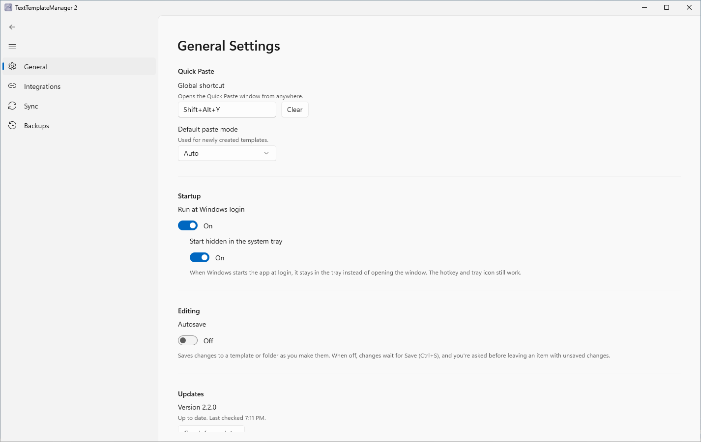

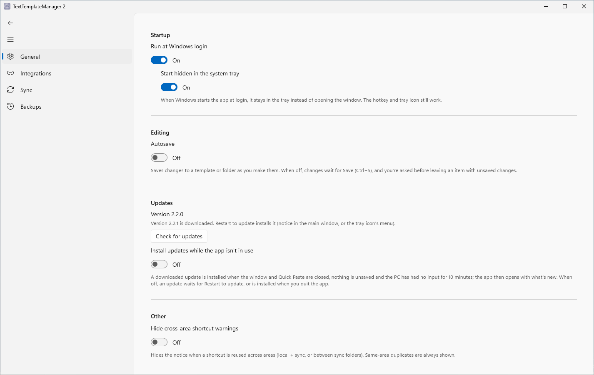

### Integrations

- **Browser extension** — enable a local connector for a companion browser extension (see below).
- **File association** — `.ttmdata` files open with this app (opening one adds it as a sync source — see the **Sync** tab). If another program took them over, **Open Default apps** takes you to Windows Settings ▸ Apps ▸ Default apps, where you can choose this app for `.ttmdata` again.

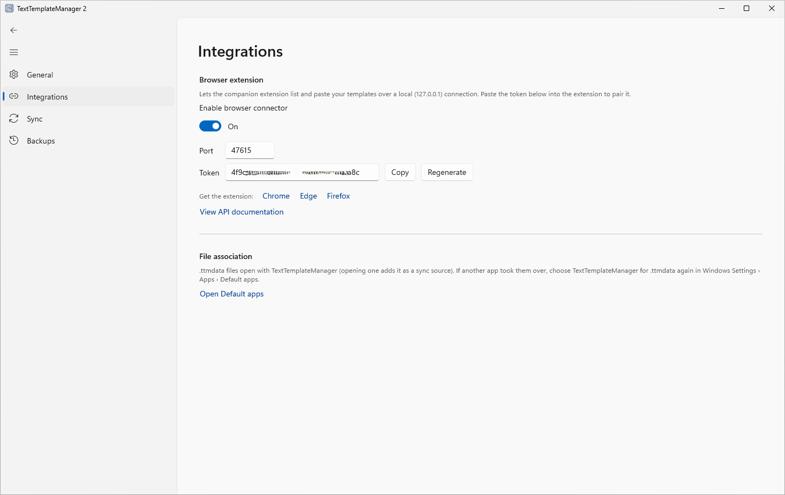

#### Browser extension

The browser connector lets a companion browser extension (Chrome, Edge, or Firefox) list your
templates, paste them from the browser, and create new templates from selected text. It is **off by
default**; turn it on with **Enable browser connector** in **Settings ▸ Integrations**.

The companion extension is [TTM-Connect](https://github.com/halatsWol/TTM-Connect), available on:

- [Chrome Web Store](https://chrome.google.com/webstore/detail/jclopjpjdldbknjdhmjldehlkgbihlmi)
- [Microsoft Edge Add-ons](https://microsoftedge.microsoft.com/addons/detail/ttm-connect/fbpmhopmnaoedcnbegdkpfblekhaindm)
- [Firefox Add-ons](https://addons.mozilla.org/addon/ttm-connect/)

When enabled, the application runs a small local service (`127.0.0.1` — loopback only, never exposed
to the network) that the extension talks to. Pairing is by **token**:

- Turn on **Enable browser connector**. A random **token** is generated and shown, along with the
  port. (only on first time Activation, a token is generated, future disable/re-enable will list the previous token)
- Copy the token (and the port, if you changed it) into the extension's settings. Every request must
  present the token, so only an extension you have paired can reach your templates.
- **Regenerate** issues a new token and invalidates the old one — re-pair the extension afterwards.
- If the port can't be used (another app already uses it, for example an older TextTemplateManager that is still running, or Windows has reserved it), the application tells you at startup and shows a warning in **Settings ▸ Integrations**. Choose a different port there and set the same port in the extension.

The connector serves template names, ids, and the available paste modes, and returns a template's
content rendered in a chosen paste mode (or the template's default). It can also **create** a new
template from content the extension sends (e.g. the current page selection); the new template is added
to your local area. Only browser extensions may use it — an ordinary web page cannot — and the
application must be running. Developers can find the full API (endpoints, security, examples) via the
**View API documentation** link in settings.

**Content safety.** Because a browser selection can contain untrusted markup, everything the extension
sends is cleaned before it becomes a template, and the content the connector hands back is cleaned the
same way. It uses a strict allow-list followed by a deny-list hardening pass:

- **Kept:** ordinary formatting — text, headings, **bold**/*italic*/underline/strikethrough, sub- and
  superscript, lists, tables, blockquotes, code blocks, text colour and highlighting, and links.
- **Code blocks are preserved exactly.** Code in any language — including HTML or JavaScript shown as
  text inside a code block — passes through untouched; it is treated as text, never as live markup.
- **Removed:** anything that could run or load from the network — `<script>`, `<style>`, embedded
  frames/objects, **images and other media**, form controls, SVG/MathML, and HTML comments (dropped
  with their contents); event-handler attributes (`onclick`, `onerror`, …); `javascript:`, `vbscript:`
  and `data:` links (only `http`, `https`, `mailto`, `tel` and relative links are kept); and active or
  remote CSS (only inert style properties such as colour, background colour, text alignment and width
  survive). Links that open a new tab get `rel="noopener noreferrer"`. Any other unrecognised tag is
  unwrapped — its text is kept, the tag is dropped.

### Sync

Synchronization lets several people, or several of your own computers, share the same set of
templates. A synchronized source is an ordinary template file stored in a shared location — most
commonly a cloud folder such as OneDrive — and surfaced in the tree as a pinned folder at the top.
Synchronized files are watched for external changes and reconciled automatically, so edits made
elsewhere appear without restarting the application.

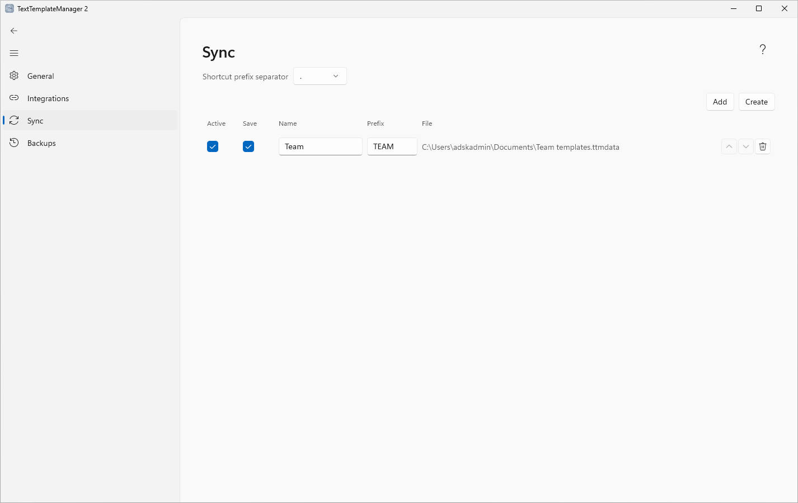

To add a source, click **Add** to link a shared file that already exists, or **Create** to make a
new one — for example in a OneDrive folder so it is shared automatically:

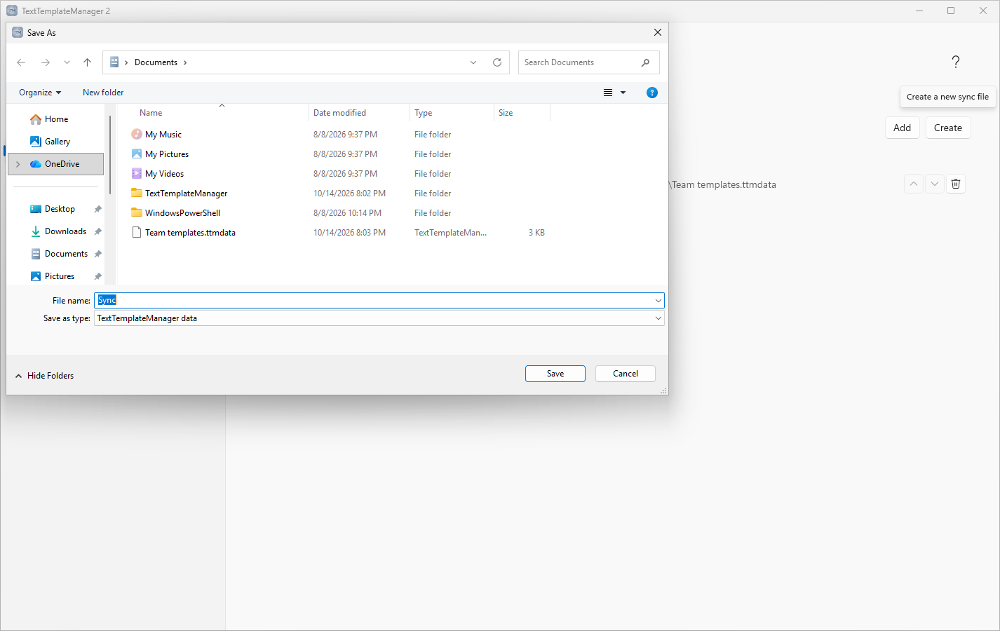

The source then appears as a row, shown in the tree as a pinned folder:

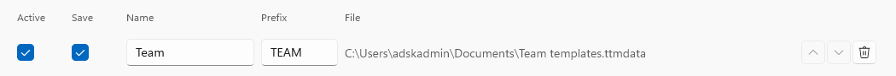

Each source offers the following options:

- **Active** — load the source into the tree as a pinned folder. Clearing this hides the folder
  without deleting the underlying file, or removing it from the list completely.
- **Save** — when enabled, the folder is editable and your changes are written back to the shared
  file. When disabled, the folder is read-only and the shared file always takes precedence on reload.
- **Name** — the folder's title as shown on this computer. It is set here only; the pinned sync
  folder's name is read-only in the tree.
- **Prefix** — the text that namespaces the folder's multi-key shortcuts (for example, a prefix of
  `AND` turns the shortcut `MSG` into `AND-MSG`). The character joining the prefix and the shortcut is
  chosen at the top of the page (**Shortcut prefix separator**): `-`, `.`, or *none* (the prefix joins
  the shortcut directly, e.g. `ANDMSG`).
- **Order** — the up and down arrows set the folder's priority (the up arrow is disabled on the top
  row and the down arrow on the bottom row). This priority determines which template wins when a
  shortcut is shared across areas, and is applied immediately.

If a source's file cannot be found (for example, it has been moved, deleted or is temporarily offline), a warning icon is shown next to it, and the folder keeps showing the contents last seen in that file (its cached copy). Click the icon to:

- **Recreate the file from the cached copy**: writes the folder back out as the sync file where it was, or, if that folder no longer exists, where you choose. The source then uses the new file.
- **Link another file…**: points the source at an existing file, for example one that was moved.

If your changes can't be saved to a source's file (for example because the file is read-only, or the shared folder refuses writes), a yellow warning icon appears on its folder in the tree and on its row here; point at it to see the reason. Your changes are kept, and the app keeps trying: as soon as the file can be written again, they are saved and the warning goes away. A file that is briefly locked, for example while OneDrive uploads it, is simply read again once it is free.

You can also add a source by **opening a `.ttmdata` file** — double-click it in File Explorer, or use
**Open with ▸ TextTemplateManager**. The app comes to the front on this page with the file linked as an active
source; if the file is already linked it is simply shown here, and the app's own data file is never
added. (TextTemplateManager runs as a single instance, so opening a file always uses the window that
is already running.)

### Translation

Here you download the languages for the editor's **Translate** button (see *Translating a template*). They are the Firefox Translations language models from Mozilla, downloaded from Mozilla's servers; the translation itself runs on this PC, and translating works without an internet connection once a language is installed. The page is marked experimental, with a reminder to check every translation.

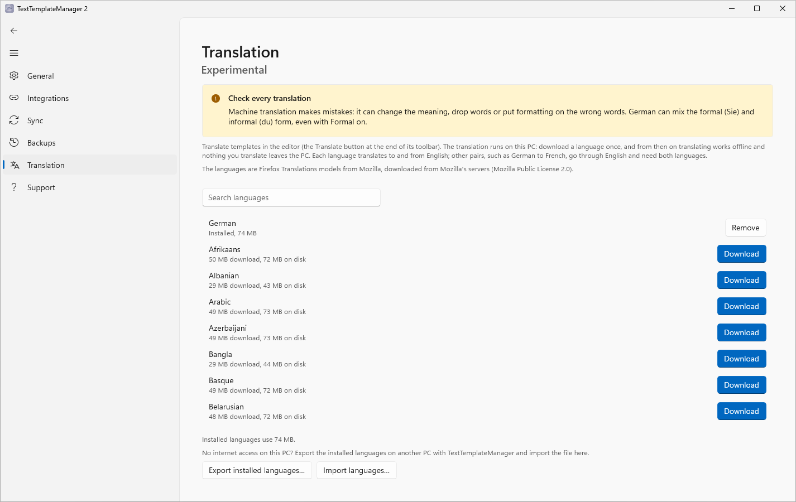

Each row is a language with its download size and the space it takes on disk, or **Installed** and the space it uses. **Download** installs it, in both directions (to and from English) where Mozilla offers both; a few languages exist in one direction only, which the row says. While it downloads, **Cancel** stops it, and the download keeps running if you leave Settings. Quitting the app while a language downloads asks first: **Wait, then exit** finishes the download and shows how far it is (that dialog can still stop it), **Stop and exit** stops it, **Cancel** keeps the app running. Every installed language has **Update**, which you can click when Mozilla has published a newer version (the row then says **update available**, otherwise **up to date**), and **Remove** deletes a language. **Search languages** filters the list. Every downloaded file is checked against Mozilla's checksums before it's used.

Mozilla publishes improved versions of the languages now and then. With **Check for newer versions of the installed languages once a day** on, the app looks once a day while it runs (the first time a few minutes after it starts); when there is a newer version, a notification says so and the language shows **Update** here. With **Download them automatically** on as well, the newer version is downloaded without asking, checked the same way. Both are off by default, and nothing goes online for it while they are off; only languages you installed are updated. While newer versions aren't downloaded automatically, **Download all updates** below the options downloads every newer version at once; the list of languages is loaded each time you open the page, so it also works with the daily check off.

For a PC without internet access, **Export installed languages…** on a PC that has them saves them as a `.zip` file, and **Import languages…** installs them from it; every file is checked before it's installed.

The list of languages comes from Mozilla's servers each time the page opens. If they can't be reached, the page says so and offers **Try again**; installed languages are still listed, can be removed and exported, and translating keeps working.

### Support

**Help & troubleshooting** opens the website's answers to common questions.

**Export logs…** saves the logs for a problem report as one `.zip` file wherever you choose: the app's update and crash logs, the installed version and update policies, and the last 14 days of Microsoft Store, app installation and app error events about TextTemplateManager. Reading the event logs can take a minute. Your templates, settings and sync files aren't included, and your user name, computer name and account ID are replaced; every file in it is plain text, so you can read it before you send it. Attach it when you report a problem with installing, updating or starting the app. If the app doesn't start at all, the log collector on the website's **Help & troubleshooting** page collects the same.

The other sections show how to reach the developer: **Report a problem**, **Suggest a feature** and **Report a security vulnerability**, each by e-mail or on GitHub. The e-mail buttons open your mail app with the questions already in the message, and the app and Windows version filled in; they also copy the address to the clipboard, in case no mail app opens. GitHub needs a GitHub account, and issues there are public; security vulnerabilities are always reported privately (see *Support*).

---

## Backup and export

- **File ▸ Export…** saves the selected folder (with everything in it) or template to a `.ttmdata` file. With nothing selected, it saves all your local templates and folders (synced folders already live in their own files).
- With several items selected, the file keeps them in tree order and keeps the folders between them: each item comes with copies of its folders down from the deepest folder the selected items share, and those copies hold only the selected items. For example, the template `f1t4` from folder F1 together with folder F2 gives `F1 ▸ f1t4` and `F2` with everything in it; two templates from `F1 ▸ Sub` and `F1 ▸ Sub2` give `Sub` and `Sub2` without F1. In a synced folder, the synced folder itself is never part of the file. Local items and items of a synced folder, or of two synced folders, can't be exported together: the export entries then show **(not across areas)** and are greyed out.
- **File ▸ Import…** adds the templates and folders of a `.ttmdata` file to your local ones. Nothing is replaced unless you choose so. You choose where they go:
  - **Into a new folder** named after the file: a separate copy, nothing is touched.
  - **Directly into the tree**: folders with the same name at the same level are merged. For templates that already exist (the same template, or one with the same title in the same folder) you choose to **overwrite all of them**, to **overwrite only where the imported one is more recent**, or to **skip them**.

  Synced folders are not affected: copies of them in older full exports are skipped. To go back to an earlier state of everything, restore a backup instead (see *Automatic backups*).
- Right-clicking a folder or template and choosing **Export…** does the same for that item, which is useful for creating a new shared source or sharing a subset of templates.

Backups use the `.ttmdata` format. An older `.json` backup still loads after you rename it to 
`.ttmdata` — the two are the same format.

### Automatic backups

The application also backs up on its own, into `Documents\TextTemplateManager\Backups` (outside the app's own folder, so they survive resetting or removing the app; if your Documents folder is backed up to OneDrive, so are they).

- **Recent**: 2 minutes after your last change, and when you quit with changes not yet backed up. The last 3 are kept.
- **Every 2 hours** while the application runs, if something changed. The last 5 are kept.
- **Daily**: at startup, and at the first change after midnight. The last 5 are kept.
- **From TextTemplateManager 1**: if version 1 was used on this PC, its data is backed up once at the first start, as it was, and this backup is never removed.

Each backup is one `.zip` file with your templates, your settings, your sync settings and a copy of every shared sync file, plus a list of their checksums. A backup only appears once it has been written completely and checked.

**Settings ▸ Backups** shows where they are (**Open backups folder**) and lists them, newest first. A damaged backup is greyed out and can't be chosen. **Export backup…** saves a backup of everything as a `.zip` file wherever you choose, for example to move your templates to another PC.

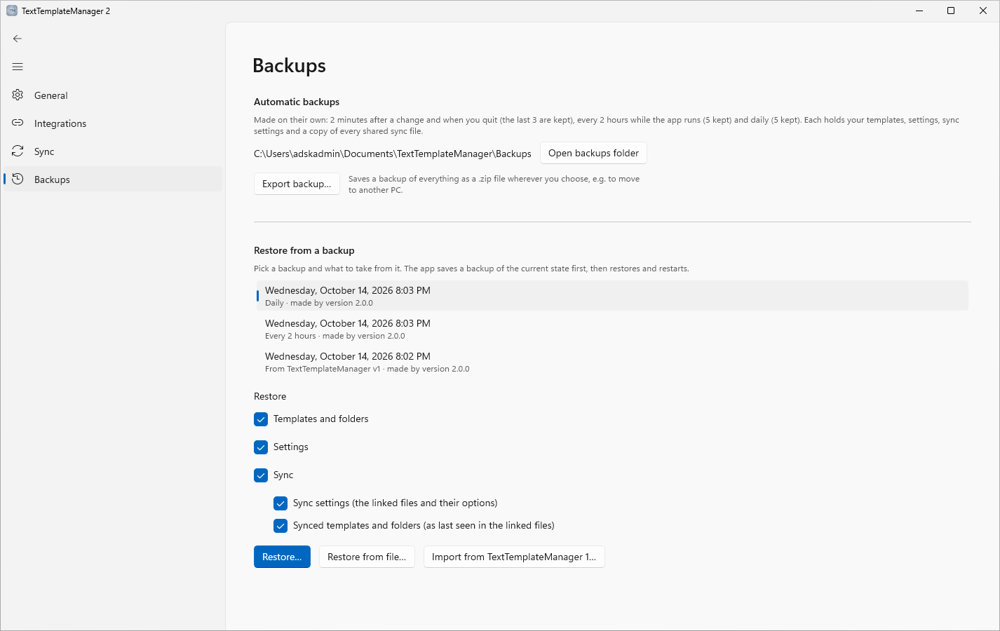

### Restoring a backup

1. In **Settings ▸ Backups**, select a backup. The newest one is selected when you open the page.
2. Choose what to restore. Everything the selected backup holds is ticked, except **Synced templates and folders**: they write into shared sync files, so tick them yourself when you want that. A part the backup doesn't hold (for example sync settings, if you had no synced folders then) is greyed out.
   - **Templates and folders**: your local templates and folders.
   - **Settings**.
   - **Sync**, made of two parts you can also choose one by one: **Sync settings** (the linked files and their options) and **Synced templates and folders** (the synced folders as last seen in their files, which is what they show while a file is missing). With only one part chosen, Sync shows a dash.
3. Click **Restore…** and confirm. To restore an exported backup instead, click **Restore from file…** and pick the `.zip` file: it is checked the same way, added to the top of the list and offered for restoring with everything it holds; cancel the confirmation to change what is ticked, then click **Restore…**. To take over version 1's data, click **Import from TextTemplateManager 1…** (shown when TextTemplateManager 1 was used on this PC): its backup is made first if there isn't one yet, then selected and confirmed the same way. Of the settings, only those version 1 had are replaced.
4. When restoring sync settings, you're asked about each linked sync file of the backup that isn't on this PC. Without **Synced templates and folders** ticked, **Choose a location…** is replaced by **Link another file…**:
   - **Recreate it there** (the folder still exists) or **Create the folder and the file** (the folder is gone too): the file is written where it was, from the backup's copy.
   - **Choose a location…**: the file is written where you choose, and the sync settings point there. This is the only way when the location can't exist on this PC, for example a drive or network share that isn't there.
   - **Leave it missing**: the synced folder shows its copy from the backup until the file is back (see **Sync** for recreating it later).
   - If the backup holds no copy of the file, you can only link another existing file instead.

   With **Synced templates and folders** ticked, you're also asked for each linked sync file you may save to (**Save** ticked in **Settings ▸ Sync**) that is there but has changed since the backup whether to keep it; the file of a read-only source always stays as it is, without asking:
   - **Keep the file** (the default): the file stays as it is, and its synced folder shows the file's contents.
   - **Overwrite with the backup's copy**: the file gets the backup's copy, for everyone who uses it.
5. When restoring **Synced templates and folders** without the sync settings, each synced folder of the backup is restored into its sync file (the one your current sync settings link, otherwise the one the backup's settings linked, which is then linked again):
   - If the file is there, its templates are merged like an import: folders with the same name are merged, and for templates that already exist you choose to overwrite all of them, overwrite only where the backup's is more recent, or keep the ones in the file.
   - If the file is missing, you get the same choices as above (recreate it, choose a location, or skip the folder).

The current state is backed up first, so a restore can itself be undone from the newest backup. The application then puts the chosen files back and restarts. If anything goes wrong, nothing is changed, and a recreated or overwritten sync file is put back as it was. A shared sync file that still exists is only overwritten when you choose so; otherwise it keeps its contents and is what its synced folder shows.

---

## Updates

TextTemplateManager updates itself from the Microsoft Store. It looks for a new version every few hours, and downloads it in the background while you keep working. The Microsoft Store allows an app one check every 30 minutes and ten a day; if you click **Check for updates** sooner, it says when the next check is possible. A new version can take a few hours after its release to show up.

When the download is done, a notice above the template list says **Update ready**. Click **Restart to update**: your work is saved first (unsaved changes are asked about, as when closing the window), the app closes, Windows installs the new version, and the app is back within a few seconds, showing what's new. The tray icon's menu has **Restart to update** too, and while the window is hidden a tray notice says when an update is ready. Not now? Quitting the app (**File ▸ Exit** or **Exit App**) also installs a downloaded update, so the next start is the new version.

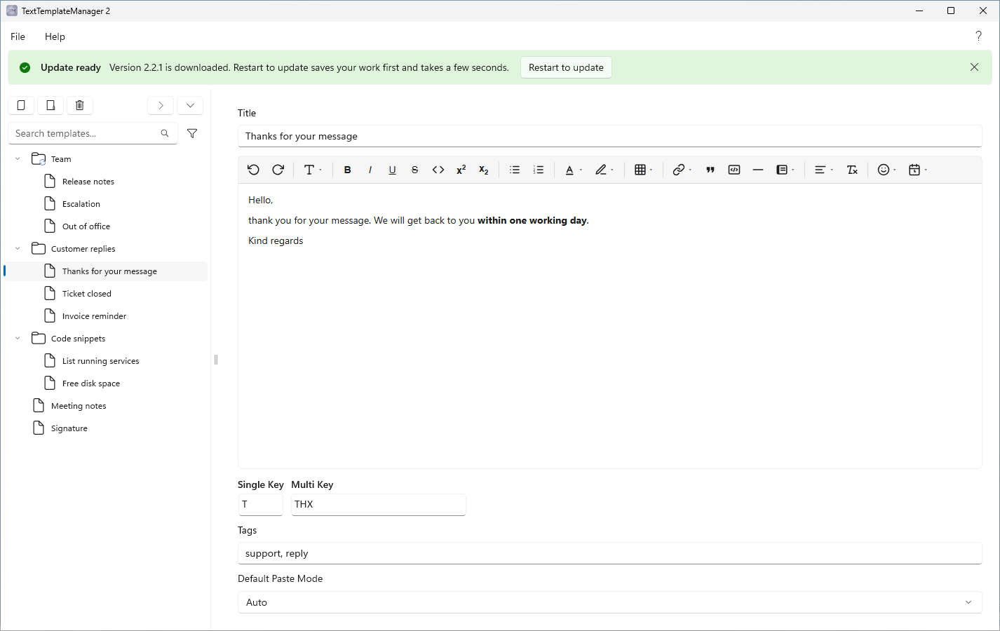

**Settings ▸ General ▸ Updates** shows the version and has **Check for updates**, which downloads a new version it finds right away; once one is ready, the button becomes **Restart to update**. To update only when you ask, turn off **Check for and download updates automatically**. With **Install updates while the app isn't in use** on (off by default), a downloaded update is installed when the window and Quick Paste are closed, nothing is unsaved and the PC has had no input for 10 minutes; the app then opens with what's new.

If automatic Store updates are turned off on this PC, TextTemplateManager still asks the Microsoft Store for its own updates: on its own with **Check for and download updates automatically** on, otherwise when you click **Check for updates** or **Download** on the notice. The Store may ask once; then the update downloads and is ready as above. If a download fails, the notice shows the error with **Try again**. Windows Update often brings the update on such PCs anyway; as soon as it's downloaded, TextTemplateManager offers **Restart to update** without asking the Store. On a company PC your IT may manage updates; the notice and the settings then say so.

If an update can't be installed (the notice says so), or to update by hand:

1. Quit the app completely: tray icon ▸ **Exit App**, or **File ▸ Exit** (closing the window only hides it).
2. Start TextTemplateManager again from the Start menu. If Windows has already downloaded the update, it's installed now, and the window opens with what's new.
3. If **Help ▸ About** still shows the old version, the update hasn't been downloaded yet: quit the app again, open **Library** in the Store app and click **Update** next to TextTemplateManager (**Get updates** only looks for updates; the update itself starts with **Update**), then start the app again.

After an update, the first time the window opens it shows what's new in that version, once (see *What's new*).

### For administrators

Installing with winget or Intune, how updates behave when the Store is restricted by company policy, start with Windows, file locations, and removing the app are covered in the **Administrator & Deployment Guide** (`TextTemplateManager-AdminManual.pdf`), attached to each release on the [Releases page](https://github.com/halatsWol/TextTemplateManager-v2/releases).

---

## Keyboard reference

| Context | Input | Action |
| --- | --- | --- |
| Main window | **Ctrl + F** | Focus the search box. |
| Main window | **Ctrl + S** | Save the changes to the selected template or folder (also in the editor). |
| Editor toolbar | **Enter** / **Esc** | Open / close a button's menu (**Tab** moves into it); in the table menu the arrow keys choose the size. |
| Main window | **Tab** / **Shift + Tab** | Go round the toolbar above the tree, the search box, the tree and the selected item's fields: title, editor toolbar, template text, shortcuts, tags, default paste mode. |
| Main window (toolbars) | **←** / **→** | Move between the buttons of the toolbar above the tree or of the editor toolbar. |
| Editor (text) | **Tab** / **Shift + Tab** | Nest / un-nest a list item, next / previous table cell, indent / outdent a code line; elsewhere move on to the shortcuts / back to the editor toolbar. **Ctrl + Tab** always moves on. |
| Main window (Tree) | **Delete** | Delete the selected item(s) (with confirmation). |
| Main window (Tree) | **Ctrl**+click / **Shift**+click | Add or remove an item / select a range of rows. |
| Main window (Tree) | **Shift + ↑ / ↓** | Extend the selection to the row above / below. |
| Main window (Tree) | **Ctrl + A** | Select all visible rows. |
| Main window (Tree) | **Ctrl + C** | Copy the selected template in its default paste mode. |
| Main window (search box) | **↑ / ↓** | Move the text cursor to the start / end; **↓** again at the end steps into the tree. |
| Main window (search box) | **Esc** | Clear the search text; when it is already empty, clear the tree selection. |
| Main window (Tree) | **Esc** | Return to the search box (the search text is kept). |
| Main window (Tree) | a letter or digit | Return to the search box and type it there. |
| Quick Paste | *key* | Paste by single-key shortcut (search box empty). |
| Quick Paste | **Ctrl + F** | Focus the search box. |
| Quick Paste (list) | **↑ / ↓** | Move the highlight through the current shortcut list (wraps at both ends). |
| Quick Paste (list) | **Enter** | Paste the highlighted shortcut. |
| Quick Paste (search box) | **↑ / ↓** | Move the text cursor to the start / end; **↓** again at the end steps into the tree. |
| Quick Paste (tree) | **↓** (at end of search) or **Tab** | Move focus into the template tree. |
| Quick Paste | **Alt** + *keys* | Paste by multi-key shortcut; release **Alt** to insert the highlighted match. |
| Quick Paste | **Alt** + *keys* + **_**| Paste by multi-key shortcut as Plain Text; release **Alt** to insert. |
| Quick Paste | **Alt** + **Backspace** | Correct the current multi-key entry. |
| Quick Paste | **Esc** | Close the Quick Paste window. |

Additional actions are available from the right-click menu, including **Duplicate**, **Copy** and **Copy As** for templates, and **Export…** and **Delete** for templates and folders.

---

## Data and file locations

Application data is stored per user in the app's own package folder:

`%LocalAppData%\Packages\MarflowSoftware.TextTemplateManager_eb1r5ey0kd4ny\LocalState`

This folder contains your template data, application settings, and synchronization configuration. Windows removes it when you uninstall the app or reset it in **Settings ▸ Apps**. Shared synchronization files are stored wherever you place them, and are not kept in this folder. The automatic backups are in `Documents\TextTemplateManager\Backups`, outside this folder, so they stay when the app is reset or removed. Downloaded translation languages are in the package's `LocalCache\TranslationModels` folder next to it; they aren't part of backups, since they can be downloaded again, and Reset and Uninstall remove them too.

Exiting from **File ▸ Exit** or the tray icon, and signing out of or shutting down Windows, first save anything still pending; if a synced file is slow to respond, a "Saving changes…" message appears until it is done. Changes to a template or folder that you haven't saved (with **Autosave** off) are asked about first, as when closing the window; when Windows signs out or shuts down, they are saved.

If one of these files can't be read at startup (for example after a crash during a save), the app keeps it as `<file>.broken-<date-time>` in this folder, tells you which file was affected, and starts without it. The original is never overwritten.

### Resetting or removing the app

In Windows **Settings ▸ Apps ▸ Installed apps**, open the **…** menu next to TextTemplateManager:

- **Advanced options ▸ Reset** deletes the app's data (templates, settings, sync settings) and starts it as on the first day; **Repair** keeps the data and only fixes the app's files. After a reset, the first start offers to restore a backup.
- **Uninstall** removes the app together with its data folder.

Neither touches the backups in `Documents\TextTemplateManager\Backups` or your shared sync files; delete those by hand if you no longer need them.

---

## Support

For questions, permission requests, or to report an issue, contact 
[contact@kmarflow.com](mailto:contact@kmarflow.com), or open the website with **Help ▸ Go to website** ([software.kmarflow.com/TextTemplateManager-v2](https://software.kmarflow.com/TextTemplateManager-v2/)): its **Help & troubleshooting** page answers common questions and has forms for problem reports and feature requests, by e-mail or on GitHub. **Settings ▸ Support** has the same buttons in the app, with the app and Windows version already filled in, and **Export logs…** for the logs to attach.

To report a security vulnerability, please don't open a public issue: write to [contact@kmarflow.com](mailto:contact@kmarflow.com), or, with a GitHub account, open the **Security** tab on the project's GitHub page and choose **Report a vulnerability**. Only the developer sees the report until a fix is out.
